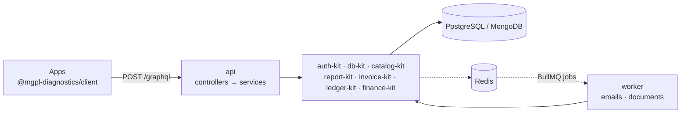

<div align="center">


# api

**The MGPL Diagnostics backend: one GraphQL endpoint for the whole lab.**

Sign-in, patients, bookings, samples, results, reports, billing, books, GST, receivables, settlements,
cash and bank, documents. TypeScript, GraphQL Yoga on Fastify, PostgreSQL or MongoDB.

[](#)
[](#)
[](LICENSE)

[Docs](docs/README.md) · [Architecture](docs/02-architecture.md) · [Getting started](docs/03-getting-started.md) · [API reference](docs/04-api-reference.md) · [Client](docs/14-client.md)

</div>

---



## What you get

- **One endpoint.** 140 queries and mutations; reports and invoices come back as base64 PDFs or HTML
  inside the response, CSV exports as text. No other routes except `GET /health`.
- **The kits as internal libraries.** auth-kit sessions and roles, db-kit storage and workflows,
  catalog-kit prices and reference ranges, report-kit and invoice-kit rendering, ledger-kit books,
  finance-kit GST and finance. See [docs/01-overview.md](docs/01-overview.md).
- **Access and refresh tokens.** Short-lived JWTs plus single-use, rotating refresh tokens bound to the
  device; logout and disabling still apply at once. See [docs/06](docs/06-auth-and-permissions.md).
- **A worker on Redis + BullMQ** for reset emails and background documents (`npm run worker`); without
  Redis the same jobs run in the API process. See [docs/16-worker.md](docs/16-worker.md).
- **Layers.** `schema/` (SDL) → `controllers/` (permissions, mapping) → `services/` (kit calls) → kits.
- **Safe by construction.** The organisation and user come from the session; every record is checked
  against them and against its branch; unknown errors are masked; depth and list limits.
- **Money in paise, books always balanced.** Every invoice, payment and credit note posts its voucher in
  the same transaction.

## Quick start

```bash
npm ci                             # kits from GitHub Packages; NODE_AUTH_TOKEN with read:packages (docs/03)
cp .env.example .env               # DATABASE_URL, …
SEED_ORG_NAME=… SEED_ORG_CODE=MGPL SEED_BRANCH_CODE=ARG01 SEED_BRANCH_NAME=Arang SEED_BRANCH_STATE=22 \
SEED_OWNER_NAME=… SEED_OWNER_EMAIL=… SEED_OWNER_PASSWORD=… npm run seed
npm run dev                        # http://localhost:4000/graphql
```

```graphql
mutation { login(input: { email: "owner@example.in", password: "…", orgCode: "MGPL" }) { token } }

query { viewer { user { name } organization { name } permissions } }
```

```ts
import { createMgplGraphQLClient } from "@mgpl-diagnostics/client";
const mgpl = createMgplGraphQLClient({ url: "http://localhost:4000/graphql" });
await mgpl.auth.login({ email, password, orgCode: "MGPL" });
const hits = await mgpl.catalog.search("cbc");
```

## Docs

Everything from A to Z is in [docs/](docs/README.md), with Mermaid diagrams: overview, architecture,
getting started, the generated API reference, errors, auth and permissions, domain flows, documents,
configuration, data and money, testing, deployment, adding a feature, client, glossary, and runnable
[examples](docs/examples/). What has to happen outside this repo (releases, org settings, deployment) is
in [docs/LOCAL-AGENT-BRIEF.md](docs/LOCAL-AGENT-BRIEF.md).

## Development

```bash
npm run typecheck
npm test                    # end-to-end over HTTP on PostgreSQL + MongoDB (TEST_BACKENDS=pg for one)
npm run build               # dist/main.js, dist/index.js
npm run schema              # schema.graphql
npm run docs:reference      # docs/04-api-reference.md
npm run llms                # llms-full.txt
```

## Part of MGPL Diagnostics

| Repo | Role |
|---|---|
| **api** | the backend: one GraphQL endpoint |
| [client](https://github.com/mgpl-diagnostics/client) | frontend SDK (zero dependencies) |
| [auth-kit](https://github.com/mgpl-diagnostics/auth-kit) · [db-kit](https://github.com/mgpl-diagnostics/db-kit) · [catalog-kit](https://github.com/mgpl-diagnostics/catalog-kit) | auth, data, test catalog |
| [report-kit](https://github.com/mgpl-diagnostics/report-kit) · [invoice-kit](https://github.com/mgpl-diagnostics/invoice-kit) | report and invoice rendering |
| [ledger-kit](https://github.com/mgpl-diagnostics/ledger-kit) · [finance-kit](https://github.com/mgpl-diagnostics/finance-kit) | books, GST and finance |
| [report-studio](https://github.com/mgpl-diagnostics/report-studio) | Next.js reference app |

<sub>© MGPL Diagnostics (Maa Gayatri Path Lab). All rights reserved; see [LICENSE](LICENSE). ledger-kit is our own software, not affiliated with Tally Solutions.</sub>
