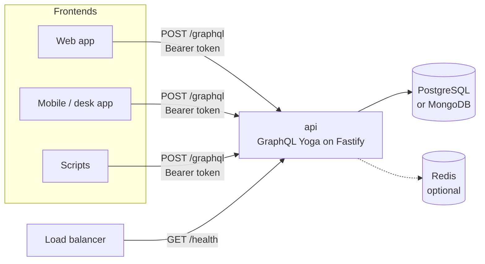

# 01 · Overview

`@mgpl-diagnostics/api` is the backend of MGPL Diagnostics (Maa Gayatri Path Lab). It serves **everything
through one endpoint, `POST /graphql`**: sign-in and users, the test catalog, patients, bookings, samples,
results and reports, billing, the books of account, GST returns, B2B receivables, partner settlements,
cash and bank, lock dates, CSV exports, and the rendered report and invoice documents.

## What it is made of

The domain logic lives in the kits, which the API uses as **internal libraries**. It has no other HTTP
routes and starts no per-kit servers. The kits never see HTTP: the API calls their functions from its
service layer.

| Kit | Role inside the API |
|---|---|
| [auth-kit](https://github.com/mgpl-diagnostics/auth-kit) | Passwords (scrypt), sessions, login rate limits, roles and permissions |
| [db-kit](https://github.com/mgpl-diagnostics/db-kit) | Repositories on PostgreSQL or MongoDB, transactions, workflows (bookings, reports, invoices) |
| [catalog-kit](https://github.com/mgpl-diagnostics/catalog-kit) | The test catalog: names, codes, prices, units, reference ranges, search |
| [report-kit](https://github.com/mgpl-diagnostics/report-kit) | Report PDFs and HTML (Navy Sidebar and classic designs) |
| [invoice-kit](https://github.com/mgpl-diagnostics/invoice-kit) | Invoice PDFs and HTML, invoice arithmetic |
| [tally-kit](https://github.com/mgpl-diagnostics/tally-kit) | Our own double-entry engine: ledgers, vouchers, books reports |
| [finance-kit](https://github.com/mgpl-diagnostics/finance-kit) | GST, GSTR-1/3B data, receivables, settlements, cash and bank, lock dates, exports |
| [security-kit](https://github.com/mgpl-diagnostics/security-kit) | Security headers on every response, the client IP behind proxies (`TRUST_PROXY`); in the client, the device signals |
| [client](https://github.com/mgpl-diagnostics/client) | Not used by the API; the frontend SDK that calls it |

## Design choices

- **One endpoint.** Reports and invoices are GraphQL fields too. A PDF arrives as base64 inside the
  response (`Document.base64`), HTML as a string, CSV exports as `CsvFile.content`.
- **Layers.** Schema (SDL) → controllers (resolvers: permissions, mapping) → services (business calls on
  the kits) → kits → database. See [02-architecture.md](02-architecture.md).
- **Tenant isolation by construction.** The organisation and the acting user come from the session,
  never from arguments. Every id is checked against the session's organisation.
- **Money in integer paise**, days as IST `"YYYY-MM-DD"`, the Indian financial year (April–March).
- **Both databases.** The same code runs on PostgreSQL (Sequelize) or MongoDB (Mongoose, replica set).

## What it is not

- Not a public API for patients. Every operation except `health`, `login`, password reset and the
  catalog needs a staff session.
- Not tax advice. GST rates, TDS and thresholds are configuration that the lab's CA must confirm
  (`verifyWithCA` lists them).
- Not integrated with Tally software. tally-kit is our own engine with Tally-like concepts.
