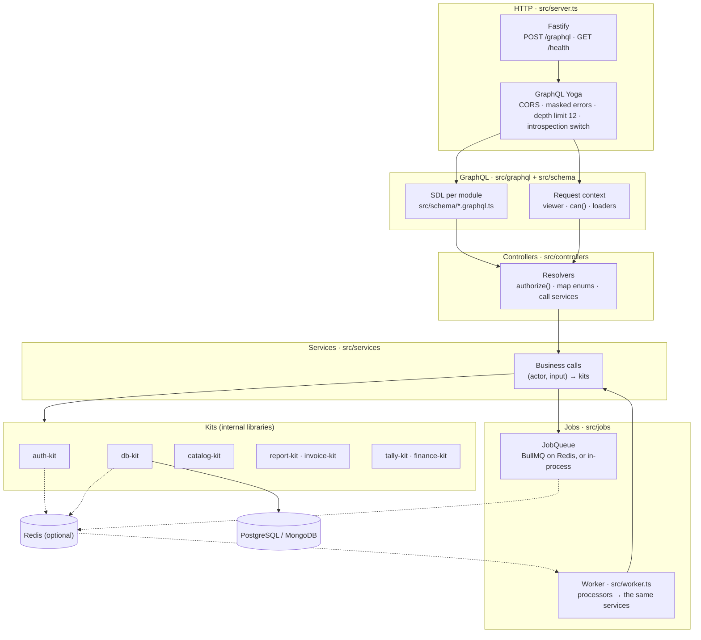
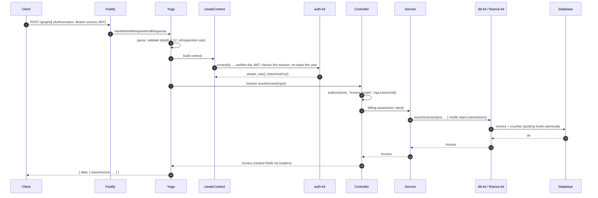
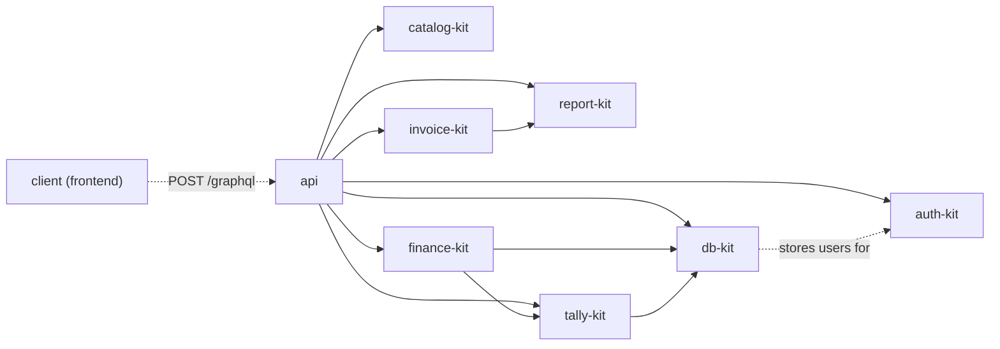
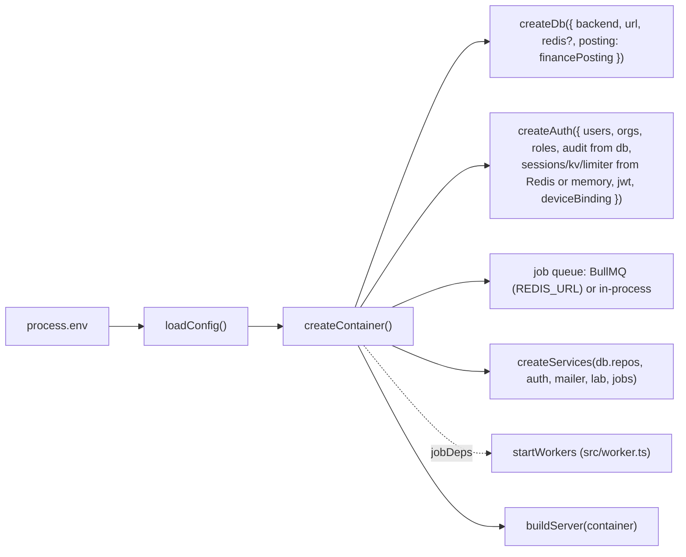

# 02 · Architecture

## Layers

Each layer talks only to the one below it. Controllers never touch the database directly except through
the per-request loaders; services never see GraphQL.



| Layer | Folder | Does | Does not |
|---|---|---|---|
| Server | `src/server.ts`, `src/main.ts` | Fastify, Yoga, `/health`, shutdown | Business logic |
| Worker | `src/worker.ts` | BullMQ workers on Redis, shutdown | HTTP |
| Jobs | `src/jobs/` | Queue (BullMQ or in-process), job payloads, processors that call services, the webhook mailer | Permissions (checked before queueing) |
| Schema | `src/schema/` | SDL, one file per module | Code |
| GraphQL plumbing | `src/graphql/` | Context, guards, errors, scalars, loaders, limits, schema assembly | Domain rules |
| Controllers | `src/controllers/` | Permissions, argument mapping, nested fields | Database writes |
| Services | `src/services/` | Calls into the kits with `(actor, input)`, transactions, ownership checks | GraphQL types or errors |
| Container | `src/container.ts` | Builds db, auth and services once per process | Per-request state |
| Config | `src/config/env.ts` | Reads and checks environment variables | Defaults that are unsafe in production |

## Folders

```
src/
  main.ts               start: loadConfig → createContainer → buildServer → listen; SIGINT/SIGTERM close
  worker.ts             start the worker: loadConfig → createContainer → startWorkers (needs REDIS_URL)
  server.ts             Fastify + Yoga (one endpoint) + GET /health
  container.ts          createDb (posting: financePosting), createAuth (JWT mode; Redis or memory stores), job queue, services
  index.ts              library entry (buildServer, createContainer, buildSchema, … for tests and embedding)
  config/env.ts         loadConfig(env) → Config
  graphql/
    schema.ts           MODULES (typeDefs + resolvers per module) → buildSchema()
    context.ts          RequestContext, createContext (bearer token → auth-kit context)
    guards.ts           actorOf, authorize, canSee, branchScope, cap
    errors.ts           ERROR_CODES, toGraphQLError, withErrorCodes
    scalars.ts          DateTime, Day, JSON
    loaders.ts          per-request BatchLoader per entity (no N+1)
    limits.ts           depthLimit
    device.ts           DeviceInput → auth-kit DeviceSignals (moves to security-kit later)
  jobs/
    types.ts            QUEUES, job payloads, JobInfo, JobQueue, JobFailure
    processors.ts       password-reset, document rendering (call services)
    bullmq.ts           createBullJobQueue (producer), startWorkers (consumer)
    inline.ts           createInlineJobQueue (no Redis: runs at once in this process)
    mailer.ts           webhookMailer (MAIL_WEBHOOK_URL)
  schema/<module>.graphql.ts      SDL
  controllers/<module>.controller.ts
  services/<area>.service.ts, index.ts (createServices), util.ts
scripts/                kits.mjs, seed.ts, print-schema.ts, api-reference.ts, llms-full.mjs
test/run.ts             end-to-end suite over HTTP (app.inject)
schema.graphql          the printed schema (CI checks it is current)
kits.json               which kit versions CI builds (see 11-testing.md)
```

Modules: `base`, `auth`, `organization`, `catalog`, `lab`, `billing`, `books`, `finance`, `documents`.

## A request, end to end



If anything throws, `withErrorCodes` turns domain errors (from db-kit, auth-kit, finance-kit,
report-kit) into GraphQL errors with a code; any other error is masked as "Unexpected error"
([05-errors.md](05-errors.md)).

## How the kits depend on each other



- db-kit's repositories satisfy auth-kit's store interfaces (users, orgs, roles, audit), so auth-kit reads
  and writes users through db-kit (`container.ts` passes `db.rawRepos`).
- db-kit posts billing to the books through a `PostingHook`. The API sets it to finance-kit's
  `financePosting`, which posts through tally-kit with GST split by place of supply.
- `src/graphql` in db-kit is an older, partial GraphQL layer. This API replaces it; db-kit will remove
  it in a major version ([LOCAL-AGENT-BRIEF.md](LOCAL-AGENT-BRIEF.md)).

## The container



One container per process. Tests build it with an embedded database and a capturing mailer; production
builds it from the environment. `close()` closes what the container opened.

## Cross-cutting rules

1. **Tenant isolation.** Services take an `Actor { userId, orgId }` from the session. `mustOwn` / `owned`
   check that a record's `orgId` matches before anything is returned or changed.
2. **Branch scoping.** `authorize(ctx, perm, branchId)` checks the record's own branch; list queries use
   `branchScope`, which narrows to the branches where the user holds the permission.
3. **Transactions.** Multi-record writes run in `repos.transaction()` inside the kits.
4. **No N+1.** Nested fields (`Booking.patient`, `Invoice.branch`, …) go through per-request loaders.
5. **Limits.** Query depth ≤ 12, list `limit` ≤ 200, request body ≤ 2 MB by default.
