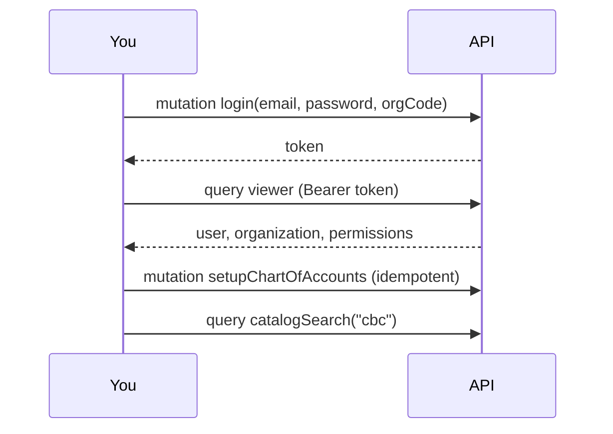

# 03 · Getting started

## Requirements

- Node.js ≥ 20 (CI uses 22)
- PostgreSQL ≥ 14, **or** MongoDB ≥ 6 running as a replica set (transactions need one)
- Redis (optional; needed when you run more than one server)
- Git (to build the kits from source until they are all on the registry)

## 1. Install

```bash
git clone https://github.com/mgpl-diagnostics/api && cd api
npm run kits          # builds the 7 kits + client from source at the refs in kits.json, then npm install
```

`npm run kits` exists because not every kit is published to GitHub Packages yet. Once they are, a plain
`npm install` (with a token that has `read:packages`) is enough; see [LOCAL-AGENT-BRIEF.md](LOCAL-AGENT-BRIEF.md).
To build from local checkouts instead of GitHub, set `KITS_SRC=/path/to/folder-with-the-kits`.

## 2. Configure

```bash
cp .env.example .env   # then edit DATABASE_URL etc.; see 09-configuration.md
```

## 3. Seed the first organisation

Once per new database. It creates the organisation, its first branch, the owner, the system roles and the
chart of accounts with finance-kit's ledgers.

```bash
SEED_ORG_NAME="Maa Gayatri Path Lab" SEED_ORG_CODE=MGPL SEED_ORG_GSTIN=22XXXXX0000X1Z5 \
SEED_BRANCH_CODE=ARG01 SEED_BRANCH_NAME=Arang SEED_BRANCH_STATE=22 \
SEED_OWNER_NAME="Lab Owner" SEED_OWNER_EMAIL=owner@example.in SEED_OWNER_PASSWORD='a long passphrase' \
npm run seed
```

- `SEED_BRANCH_STATE` is the GST state code of the branch (22 = Chhattisgarh). **Billing needs it**: the
  posting hook decides CGST+SGST vs IGST from it.
- `SEED_ORG_GSTIN` is optional for billing but **required for GSTR-1 / GSTR-3B**.
- The password must pass auth-kit's policy (length, not containing the email or name, not common).

## 4. Run

```bash
npm run dev            # tsx watch, http://localhost:4000/graphql (GraphiQL in development)
# or
npm run build && npm start
```

## 5. First calls



```bash
curl -s localhost:4000/graphql -H 'content-type: application/json' \
  -d '{"query":"mutation($i: LoginInput!){ login(input: $i){ token user { name } } }","variables":{"i":{"email":"owner@example.in","password":"…","orgCode":"MGPL"}}}'

curl -s localhost:4000/graphql -H 'content-type: application/json' -H "authorization: Bearer $TOKEN" \
  -d '{"query":"{ viewer { user { name } organization { name branches { code stateCode } } permissions } }"}'
```

More in [examples/](examples/): a full day at the desk ([lab-day.graphql](examples/lab-day.graphql)),
billing and books ([billing-and-books.graphql](examples/billing-and-books.graphql)), finance
([finance.graphql](examples/finance.graphql)) and documents ([documents.graphql](examples/documents.graphql)).

## 6. Useful commands

```bash
npm run typecheck
npm test                      # end-to-end on PostgreSQL and MongoDB (TEST_BACKENDS=pg to pick one)
npm run schema                # rewrite schema.graphql
npm run docs:reference        # rewrite docs/04-api-reference.md
npm run llms                  # rewrite llms-full.txt
```
