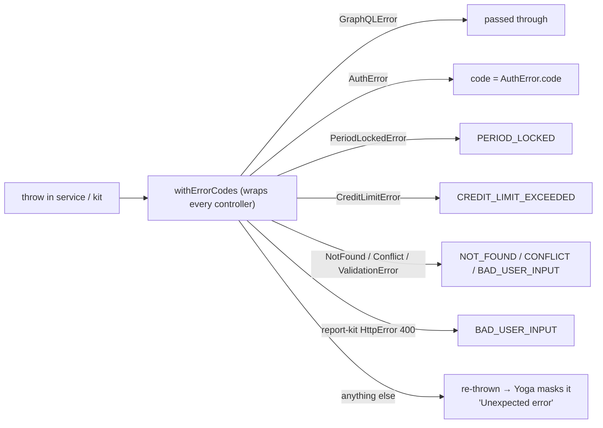

# 05 · Errors

Every error in a response carries `extensions.code`. Clients switch on the code, never on the message.

```json
{ "errors": [{ "message": "Missing permission invoice:create", "path": ["issueInvoice"],
               "extensions": { "code": "FORBIDDEN", "permission": "invoice:create" } }],
  "data": null }
```

## Codes

| Code | HTTP-ish | Raised when | Client should |
|---|---|---|---|
| `UNAUTHENTICATED` | 401 | No token, expired, logged out, or the user was disabled | Send the user to sign in |
| `FORBIDDEN` | 403 | The user lacks the permission (at that branch). `extensions.permission` names it | Hide the action; explain |
| `NOT_FOUND` | 404 | The id does not exist **in this organisation** (other tenants' ids look the same) | Show "not found" |
| `BAD_USER_INPUT` | 400 | Validation failed (db-kit `ValidationError`, report-kit 400s, unknown catalog codes, …) | Show the message next to the form |
| `CONFLICT` | 409 | Duplicate key, or the wrong state (e.g. release before verify, cancel a paid invoice) | Refresh and show the message |
| `PERIOD_LOCKED` | 409 | A posting date is on or before a lock date | Ask an accountant; pick another date |
| `CREDIT_LIMIT_EXCEEDED` | 409 | A B2B invoice would exceed the customer's credit limit | Collect payment or raise the limit |
| `INVALID_CREDENTIALS` | 401 | Wrong email, organisation or password (same answer for each) | "Email or password is wrong" |
| `ACCOUNT_DISABLED` | 403 | The user is disabled | Contact an administrator |
| `INVITE_PENDING` | 403 | The user has not set a password yet | Use the reset link |
| `ORG_REQUIRED` | 400 | The email exists in more than one organisation | Ask for the organisation code |
| `RATE_LIMITED` | 429 | Too many attempts; `extensions.retryAfterMs` says how long to wait | Wait, then retry |
| `WEAK_PASSWORD` | 400 | The new password fails the policy | Show the message |
| `INVALID_TOKEN` | 400 | A reset token is unknown, used or expired | Request a new link |
| `GRAPHQL_VALIDATION_FAILED` | 400 | The document is invalid (unknown field, depth > 12, introspection off) | Fix the query |
| `INTERNAL_SERVER_ERROR` | 500 | Anything else. The message is masked as "Unexpected error" | Retry later; check server logs |

## How errors are made



Source: `src/graphql/errors.ts`. Two rules there matter:

1. **Never pass `originalError`** to a `GraphQLError`. Yoga masks any error that wraps a non-GraphQL
   error, which would hide the code.
2. **Unknown errors stay masked.** Stack traces and SQL never reach clients. They are logged on the server.

## Adding a code

Codes are a public contract: add new ones, never rename. Add it to `ERROR_CODES`, map the domain error in
`toGraphQLError`, document it here and in the client's `docs/graphql.md`, and add a test.
