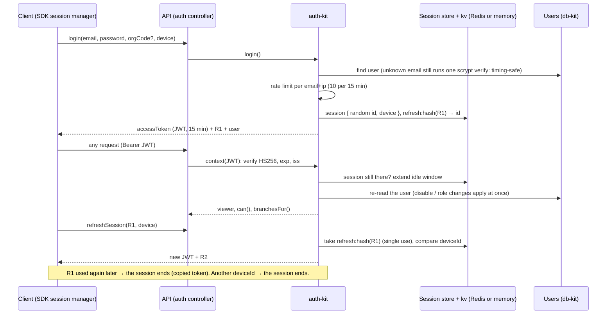
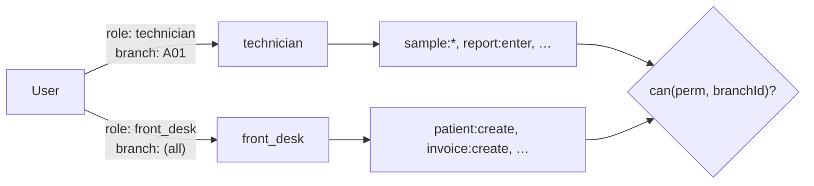
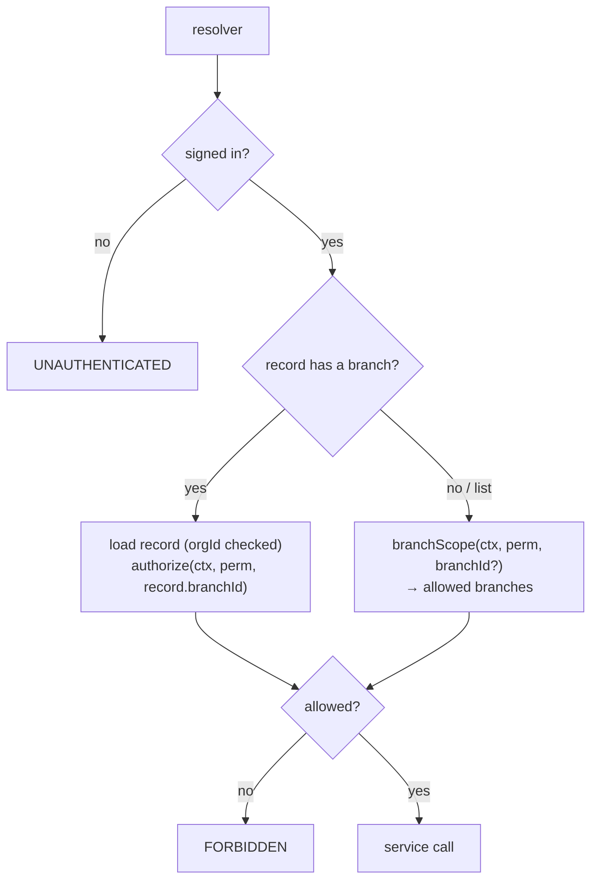
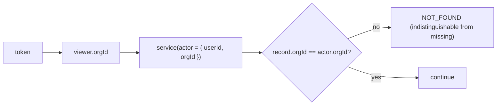

# 06 · Auth and permissions

## Sessions: access and refresh tokens

auth-kit owns passwords and sessions (JWT mode). `login` returns two tokens:

- **access token**: an HS256 JWT `{ sub, org, sid, iat, exp, iss }`, valid 15 minutes, sent as `Authorization: Bearer`;
- **refresh token**: opaque and single-use. `refreshSession` spends it and returns a new pair.

Revocation still applies at once: every request checks that the session (`sid`) exists and re-reads
the user. No store ever holds a raw token, only `hashToken(token)` (SHA-256).

| Setting | Default | Env |
|---|---|---|
| Access-token lifetime | 15 minutes | `ACCESS_TOKEN_TTL_MS` |
| Signing secret(s) | random per process in development; **required** in production | `JWT_SECRET` (≥ 32 characters; comma-separated to rotate: the first signs) |
| Issuer | `mgpl-api` | `JWT_ISSUER` |
| Idle timeout (refresh token lifetime, slides) | 12 hours | `SESSION_IDLE_MS` |
| Maximum age | 30 days | `SESSION_MAX_AGE_MS` |
| Device binding | `enforce` | `DEVICE_BINDING` (`enforce`, `flag`, `off`) |
| Login attempts | 10 per 15 minutes | (auth-kit default) |

- **Rotation.** A spent refresh token presented again within 15 s (two tabs refreshing at once) is only
  refused; later, it ends the session and is audited (`auth.refresh_reuse`).
- **Logout.** `logout` ends the bearer's session, or the session of `logout(refreshToken)` (works with an
  expired access token).
- **Rotating the secret.** Set `JWT_SECRET=new,old`, deploy, wait 15 minutes, then set `JWT_SECRET=new`.

Session operations: `mySessions` (with `deviceId` and `deviceInfo`), `revokeSession`, `logout`, `logoutOtherSessions`.

### Device signals

The client sends `device: DeviceInput` with `login` and `refreshSession`. The SDK collects these values;
any client may send them.

| Field | What it is | Server use |
|---|---|---|
| `deviceId` | random id kept by the client per browser profile or install | stored at login; a refresh from another `deviceId` → `INVALID_TOKEN`, the session ends, audit `auth.device_mismatch` (`DEVICE_BINDING=flag` only audits) |
| `fingerprint` | client-side SHA-256 of coarse device attributes (security-kit) | a change is audited (`auth.fingerprint_changed`), never blocked |
| `clientSessionId` | random id per tab or app run | stored (latest) |
| `info` | os, browser, major browser version, mobile, language, timezone, screen (client 1.3.0+; older clients sent platform, cores, memory, touch points and the user agent) | stored (latest), shown in `mySessions.deviceInfo` |

Values are untrusted: auth-kit's `cleanDeviceSignals` keeps ids of 8–128 safe characters and at most
20 short `info` values. A session that signed in without a `deviceId` is bound by its first refresh that
sends one. The client collects the signals with [security-kit](https://github.com/mgpl-diagnostics/security-kit); `src/graphql/device.ts` maps them to auth-kit. `changePassword`
ends the user's other sessions; `resetPassword`, an administrator's `setUserPassword` and `disableUser`
end all of them.

### TLS fingerprint

A TLS fingerprint (JA4, or the older JA3) describes the client's TLS library from its ClientHello. No
client code can collect it: whatever terminates TLS computes it. In production that is the reverse proxy,
which sends it in a request header; set `TLS_FINGERPRINT_HEADER` to that header's name (e.g. `x-ja4`).

| Step | Where |
|---|---|
| The proxy sets the header | security-kit README, "TLS fingerprint": nginx with a JA4 module (`proxy_set_header X-JA4 $http_ssl_ja4;`), Envoy (`%TLS_JA4_FINGERPRINT%`), CloudFront (`CloudFront-Viewer-JA4-Fingerprint`), Cloudflare Bot Management (`cf.bot_management.ja4`) |
| The api reads it, only through trusted proxies | security-kit's `fastifySecurity({ trustedHops, tlsFingerprintHeader })` → `request.security.tlsFingerprint` (`src/server.ts`), then `ctx.tlsFingerprint` |
| login and `refreshSession` pass it to auth-kit | `src/controllers/auth.controller.ts` |
| Stored as a SHA-256 hash on the session | auth-kit `Session.tlsFingerprintHash` |
| On refresh, a different one is audited | `auth.tls_fingerprint_changed` (both hashes); `auth.device_mismatch` records `tls: same / changed / null` |

The header has the same trust model as X-Forwarded-For: it is ignored unless `TRUST_PROXY` ≥ 1 (the api
refuses to start with `TLS_FINGERPRINT_HEADER` but no trusted proxy), and the proxy must overwrite any
value a client sent. A missing or malformed fingerprint is never an error. A change never ends the
session, whatever `DEVICE_BINDING` says: browser updates and TLS-inspecting networks change it too. It is
not in the GraphQL schema; clients send nothing new.

### Password reset

`requestPasswordReset(email, orgCode?)` always returns `true`, whether or not the account exists, and
only queues a job. The worker ([16-worker.md](16-worker.md)), or the API itself without Redis, creates
the token and sends `PASSWORD_RESET_URL?token=…` through the `Mailer` (mail-kit over `SMTP_URL`,
`MAIL_WEBHOOK_URL`, or `createContainer({ config, mailer })`). The token is never returned by the API and never stored raw.
`resetPassword(token, newPassword)` consumes it once.

## Permissions

A permission is `resource:action`. Roles grant permissions, with wildcards (`invoice:*`, `*:read`, `*:*`).
A user holds roles **per branch** (`branchId`) or **organisation-wide** (`branchId: null`).

`can(permission, branchId)` is true when a role held at that branch, or organisation-wide, grants it.
Without a branch, a role at any branch counts. `permissions` (query) lists every name the API checks;
`viewer { permissions(branchId) can(permission, branchId) branchesFor(permission) }` lets a UI hide what
the user cannot do.

### System roles (auth-kit `SYSTEM_ROLES`)

| Role | Summary |
|---|---|
| `owner` | Everything (`*:*`) |
| `admin` | Branches, users, roles, all lab and billing work, `accounts:*`, audit, settings (not `org:update`) |
| `branch_manager` | Patients, bookings, samples, billing, payments; reads reports, releases them; reads accounts |
| `front_desk` | Registers patients, books tests, issues invoices, takes payments |
| `phlebotomist` | Reads bookings, collects samples |
| `technician` | Samples, enters results |
| `pathologist` | Reports: enter, verify, release, amend |
| `accountant` | Payments, invoice cancellation, all `accounts:*` (books, GST, finance), audit |
| `doctor` | Reads patients and reports |

Organisations can add their own roles with `upsertRole` (system roles cannot be changed).

**No escalation.** Granting a role (`createUser`, `setUserRoles`), managing a user (`setUserRoles`,
`setUserPassword`, `disableUser`, `enableUser`) and defining a role (`upsertRole`) need, besides the
permission itself, **every permission of the roles involved**, held in the same branch or
organisation-wide (an organisation-wide grant needs organisation-wide roles). A custom "user manager"
role with `user:create` can create front-desk users only if it holds the front desk's permissions, and
can never mint an owner, promote itself, or set the owner's password: `FORBIDDEN`.

### How a resolver checks

- Single records are loaded first (checking `orgId`), then authorised **against their own branch**, so
  a user cannot read another branch's booking by guessing its id.
- Lists are filtered to the branches where the user holds the permission.
- Nested fields the user may not see (e.g. `Patient.invoices` without `invoice:read`) resolve to empty
  lists, not errors.
- Books, GST and finance need `accounts:read` (reports), `accounts:post` (vouchers, settlements, cash,
  bank) or `accounts:manage` (chart, tax rules, lock dates, year end).

The generated [04-api-reference.md](04-api-reference.md) lists the exact permission per operation.

## Tenant isolation

No operation accepts an `orgId`. Inputs that reference other records (patient, branch, invoice, ledger,
customer, partner) are checked against the session's organisation before use.
