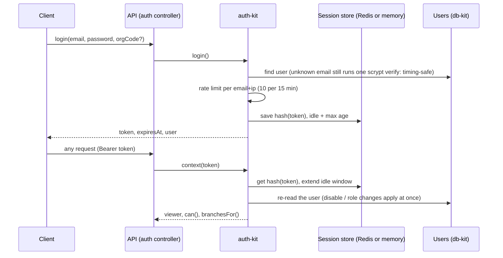
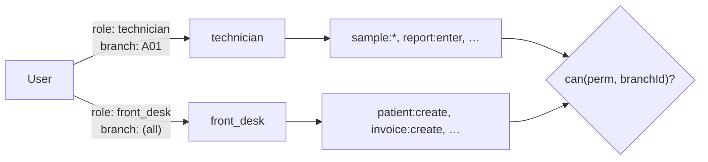
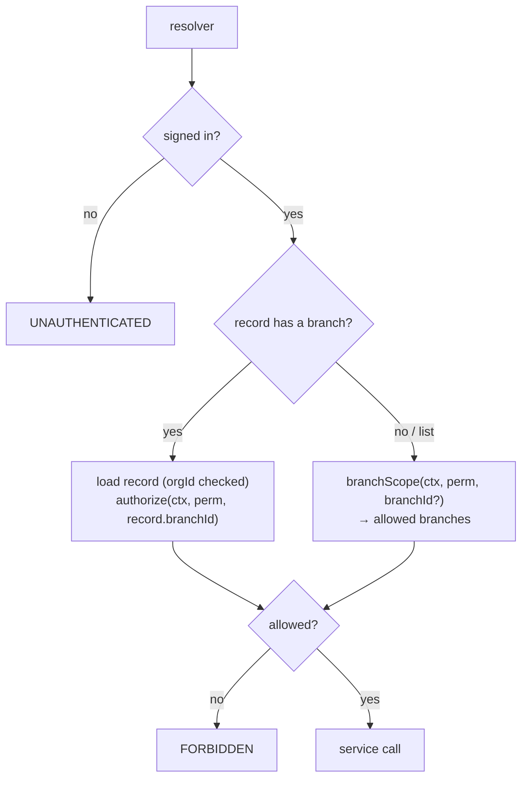
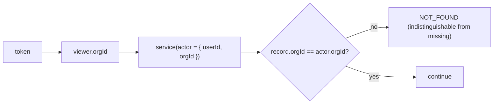

# 06 · Auth and permissions

## Sessions

auth-kit owns passwords and sessions. The API never sees a password hash leave the server and never
stores a raw token: stores receive `hashToken(token)` (SHA-256) only.

| Setting | Default | Env |
|---|---|---|
| Idle timeout | 12 hours | `SESSION_IDLE_MS` |
| Maximum age | 30 days | `SESSION_MAX_AGE_MS` |
| Login attempts | 10 per 15 minutes | (auth-kit default) |

Session operations: `mySessions`, `revokeSession`, `logout`, `logoutOtherSessions`. `changePassword`
ends the user's other sessions; `resetPassword`, an administrator's `setUserPassword` and `disableUser`
end all of them.

### Password reset

`requestPasswordReset(email, orgCode?)` always returns `true`, whether or not the account exists. When it
does, the server's `Mailer` receives the link `PASSWORD_RESET_URL?token=…`. The token is never returned by
the API. `resetPassword(token, newPassword)` consumes it once.

The `main.ts` entry has no mailer; embed the API with `createContainer({ config, mailer })` to send
emails ([12-deployment.md](12-deployment.md)).

## Permissions

A permission is `resource:action`. Roles grant permissions, with wildcards (`invoice:*`, `*:read`, `*:*`).
A user holds roles **per branch** (`branchId`) or **organisation-wide** (`branchId: null`).

`can(permission, branchId)` is true when a role held at that branch, or organisation-wide, grants it.
Without a branch, a role at any branch counts. `permissions` (query) lists every name the API checks;
`viewer { permissions(branchId) can(permission, branchId) branchesFor(permission) }` lets a UI hide what
the user cannot do.

### System roles (auth-kit `SYSTEM_ROLES`)

| Role | Summary |
|---|---|
| `owner` | Everything (`*:*`) |
| `admin` | Branches, users, roles, all lab and billing work, `accounts:*`, audit, settings (not `org:update`) |
| `branch_manager` | Patients, bookings, samples, billing, payments; reads reports, releases them; reads accounts |
| `front_desk` | Registers patients, books tests, issues invoices, takes payments |
| `phlebotomist` | Reads bookings, collects samples |
| `technician` | Samples, enters results |
| `pathologist` | Reports: enter, verify, release, amend |
| `accountant` | Payments, invoice cancellation, all `accounts:*` (books, GST, finance), audit |
| `doctor` | Reads patients and reports |

Organisations can add their own roles or override these with `upsertRole`.

### How a resolver checks

- Single records are loaded first (checking `orgId`), then authorised **against their own branch**, so
  a user cannot read another branch's booking by guessing its id.
- Lists are filtered to the branches where the user holds the permission.
- Nested fields the user may not see (e.g. `Patient.invoices` without `invoice:read`) resolve to empty
  lists, not errors.
- Books, GST and finance need `accounts:read` (reports), `accounts:post` (vouchers, settlements, cash,
  bank) or `accounts:manage` (chart, tax rules, lock dates, year end).

The generated [04-api-reference.md](04-api-reference.md) lists the exact permission per operation.

## Tenant isolation

No operation accepts an `orgId`. Inputs that reference other records (patient, branch, invoice, ledger,
customer, partner) are checked against the session's organisation before use.
