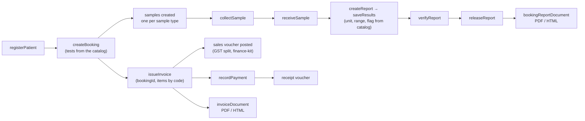
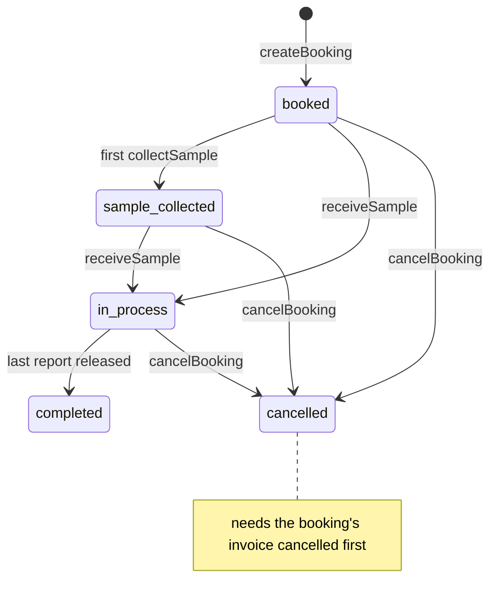
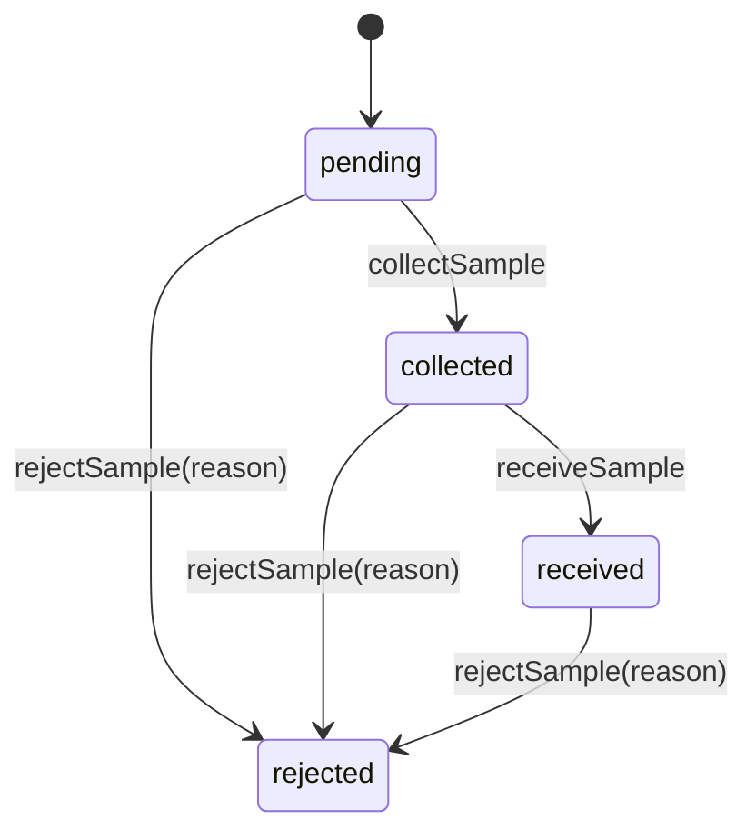
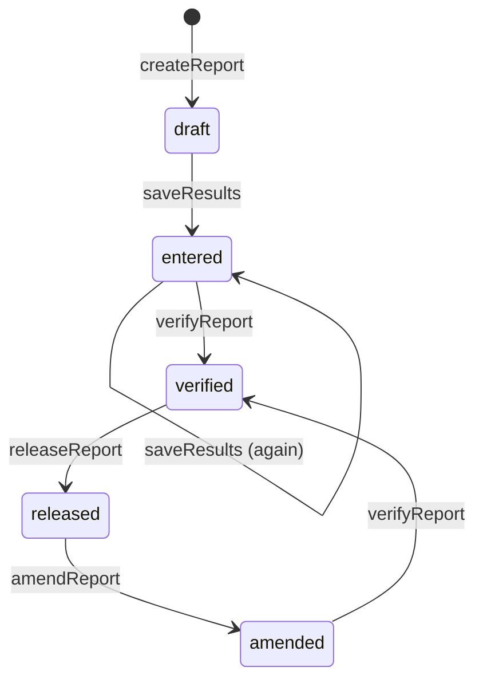
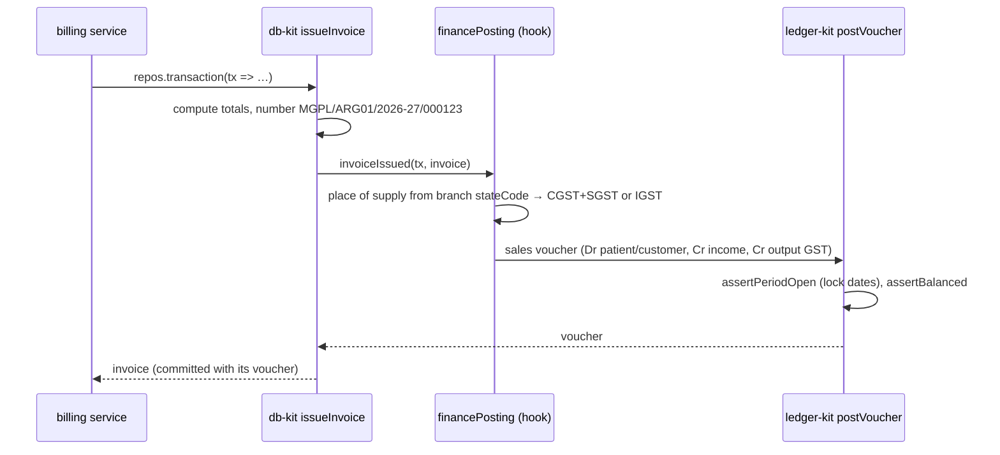
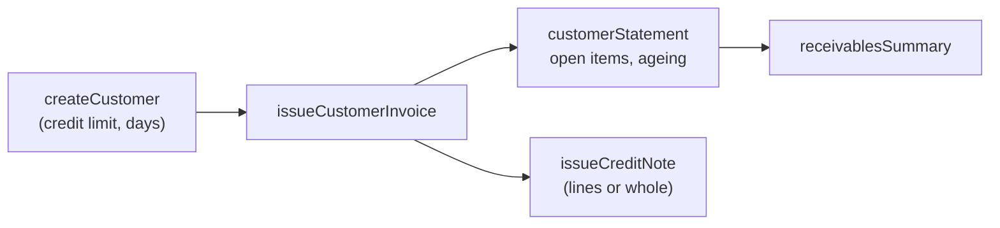
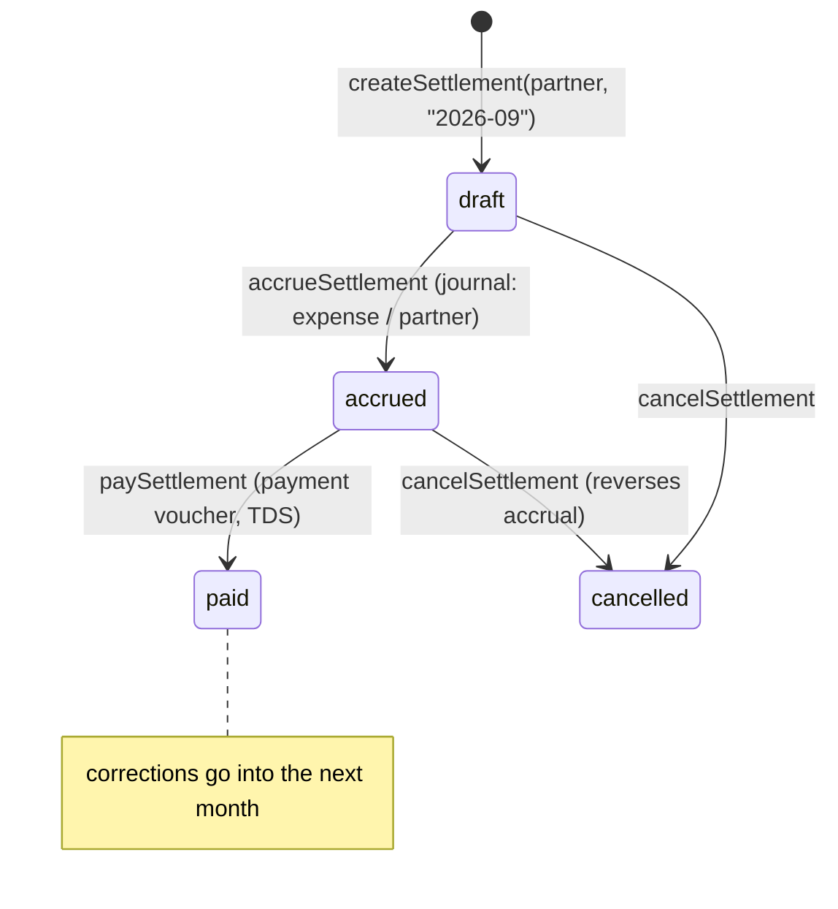
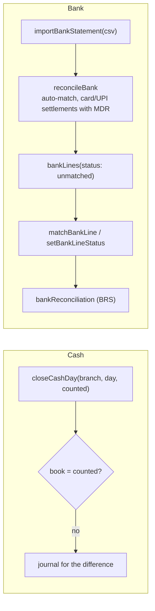
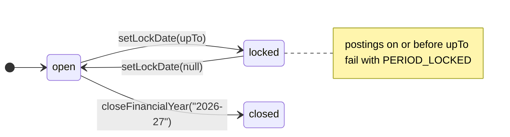

# 07 · Domain flows

## The lab day, end to end

## Booking

`createBooking` accepts `tests: [{ testCode }]`; the name, price (paise) and sample type come from the
catalog unless given. One sample (with a barcode) is created per distinct sample type.

## Sample

## Report

`saveResults` fills `unit`, `range` (by the patient's sex) and `flag` (L / H by the reference interval) from
the catalog when the client leaves them out. `flag: NONE` means normal. Releasing the last report of a
booking marks the booking `completed`. `bookingReportDocument` prints verified or released reports only ([08-documents.md](08-documents.md)).

## Invoice and payments

```mermaid
stateDiagram-v2
  [*] --> issued: issueInvoice (nothing paid)
  [*] --> partially_paid: issueInvoice with part payment
  [*] --> paid: issueInvoice paid in full
  issued --> partially_paid: recordPayment
  partially_paid --> paid: recordPayment
  issued --> paid: recordPayment
  paid --> partially_paid: refundPayment (part)
  paid --> refunded: refundPayment (all)
  issued --> credited: issueCreditNote (whole value)
  partially_paid --> credited: issueCreditNote
  issued --> cancelled: cancelInvoice(reason)
  refunded --> cancelled: cancelInvoice(reason)
  note right of cancelled: only with nothing paid; refund first
```

- Items may be just `{ code: "CBC" }`: name and MRP come from the catalog. `applyTaxRules: true` takes
  HSN/SAC, taxability and rate from the organisation's tax rules (diagnostic services are usually exempt).
- Arithmetic (db-kit, integer paise): line gross → line discount → bill discount shared by largest
  remainder → GST → round-off to the rupee.
- Every issue, payment, refund, credit note and cancel posts a voucher **in the same transaction**
  (`financePosting` → ledger-kit). A failed posting rolls the whole operation back.

## B2B receivables

`issueCustomerInvoice` refuses with `CREDIT_LIMIT_EXCEEDED` when the customer's open balance plus this
invoice exceeds the limit. Credit notes reverse tax line by line and reduce what is owed.

## Partner settlements (collection centres, franchises)

`settlementPreview` computes the month without saving: lines per invoice from the partner's agreements
(revenue share in basis points, or fixed rates per test code), deductions, TDS (section and rate from the
partner or the finance config) and net. No doctor referral commissions: settlements are for collection
centres and franchises only.

## Cash and bank

## Periods

`closeFinancialYear` posts the closing vouchers on 31 March (income and expenses into capital) and locks
the year. Lock dates are checked inside the posting transaction, so nothing slips past them.

## Books

`setupChartOfAccounts` seeds the 28 standard groups, the default ledgers and finance-kit's ledgers
(idempotent; the seed script runs it). Reports: `trialBalance`, `ledgerStatement`, `cashBook`, `dayBook`,
`profitAndLoss`, `balanceSheet`, `outstandingReceivables`, `gstSummary`. Manual entries go through
`postVoucher` (balanced, one side per line) and `cancelVoucher`.
