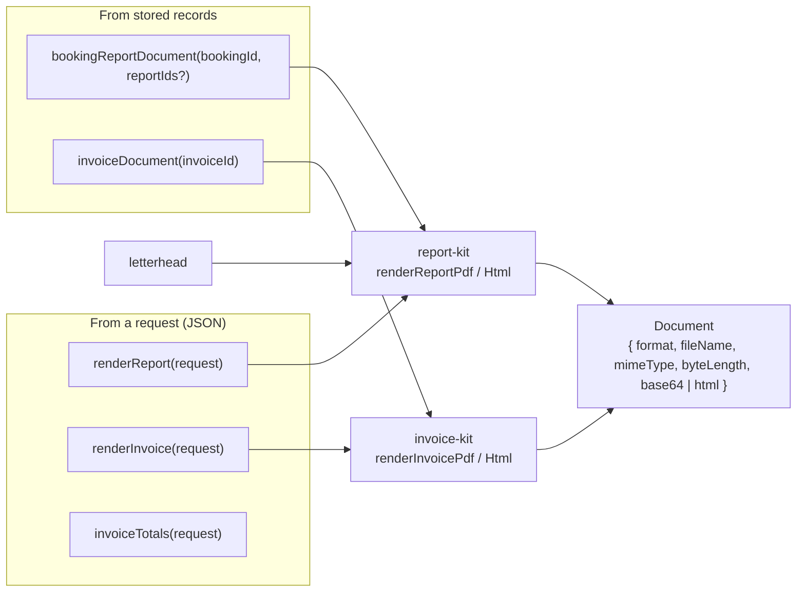
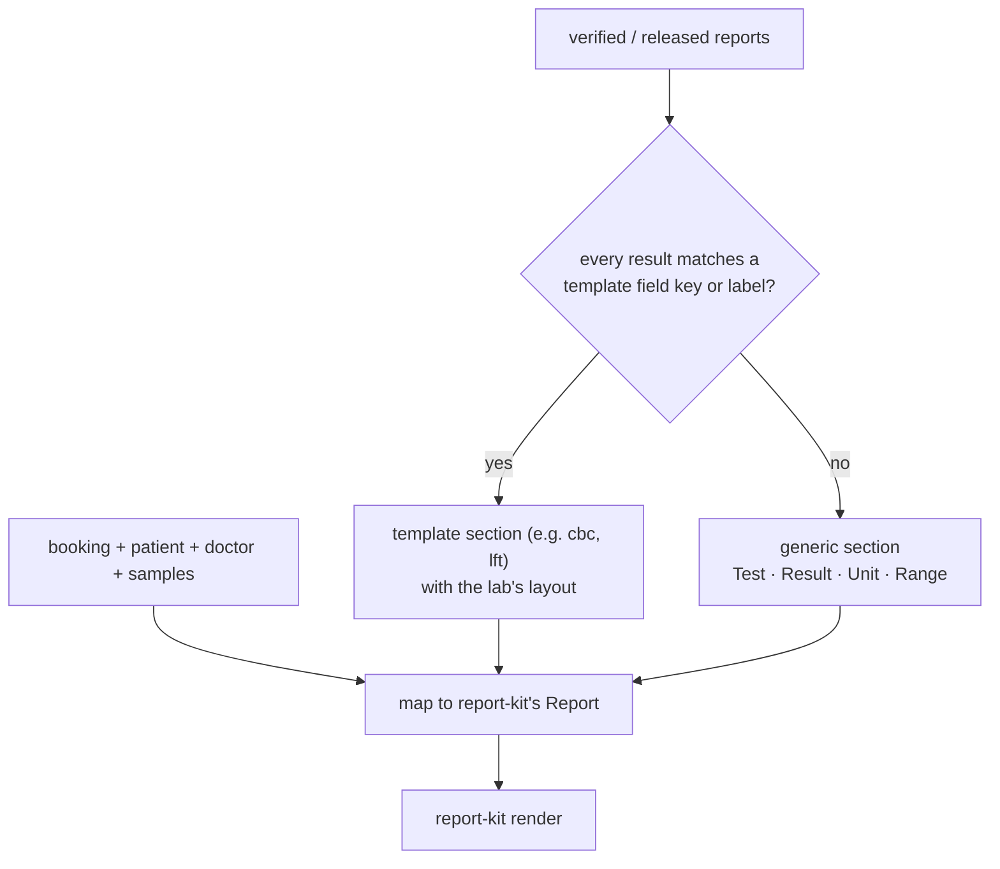

# 08 · Documents (reports and invoices)

report-kit and invoice-kit render inside the API process. There is no separate document server and no
REST route: documents travel in GraphQL responses.

## The Document type

| Field | PDF | HTML |
|---|---|---|
| `format` | `pdf` | `html` |
| `mimeType` | `application/pdf` | `text/html; charset=utf-8` |
| `base64` | the file | null |
| `html` | null | a self-contained page (fonts and images inlined) |
| `byteLength` | size of the PDF | size of the HTML (UTF-8) |

Arguments: `format` (`pdf` default), `variant` (`header` prints the letterhead; `non_header` for
pre-printed paper, same positions otherwise), `design` (`sidebar` default, or `classic`) for reports.

In a browser: `documentBlob(doc)` from `@mgpl-diagnostics/client` gives a Blob for download, a new tab or
printing ([14-client.md](14-client.md)).

## Stored reports → print

The sample-collection time is the earliest `collectedAt` of the booking's samples. Draft or entered
reports never print: if any selected report is not verified or released the call fails with `CONFLICT`
(pass `reportIds` to print only the ready ones), and `NOT_FOUND` when there are none.

## Stored invoices → print

The stored invoice (paise) is mapped to invoice-kit's print shape (rupees). invoice-kit recomputes the
totals; the API checks that its total equals the stored total and refuses a mismatch (`CONFLICT`), so a
printed invoice can never disagree with the books.

## Ad-hoc rendering

`renderReport(request)` and `renderInvoice(request)` take the same JSON as report-kit's and invoice-kit's
HTTP APIs did (`ReportRequest`: patient + tests | profile | report | sample; `InvoiceRequest`:
`{ invoice }` or `{ sample }`). They are for previews (result entry with a live preview, quotes). Samples
(`documentSamples`, `invoiceSamples`, `{ sample: id }`) work only when `MGPL_SAMPLES=true`.

## Signatures and branding

The lab profile is `defaultLab()` from report-kit: branding plus signatures read from
`MGPL_SIGNATURE_HEADER_FILE` / `MGPL_SIGNATURE_NONHEADER_FILE` (or `MGPL_SIGNATURE_FILE`). The files live
outside every repository. Without them a placeholder signature prints. Embedders can pass their own
`lab` to `createContainer`.

## Cost

A PDF takes tens to a few hundred milliseconds of CPU and the response is about 4/3 of the file size
(base64). Keep `BODY_LIMIT_BYTES` for requests; responses are not limited. Render on demand; cache the
result client-side if the same document is opened repeatedly.
