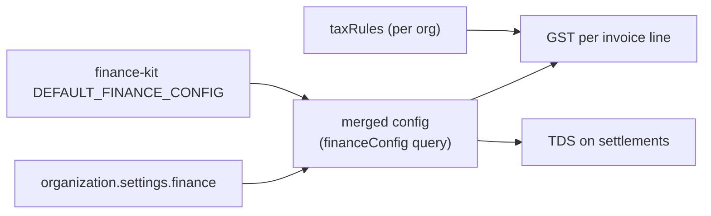

# 09 · Configuration

All configuration comes from environment variables, read once by `loadConfig()` (`src/config/env.ts`).
Copy `.env.example` to `.env` for local work; never commit it.

| Variable | Default | Notes |
|---|---|---|
| `NODE_ENV` | `development` | `production` turns off GraphiQL, introspection, samples and `*` CORS by default |
| `HOST` | `0.0.0.0` | |
| `PORT` | `4000` | |
| `GRAPHQL_PATH` | `/graphql` | The one endpoint |
| `DB_BACKEND` | `pg` | `pg` or `mongo` |
| `DATABASE_URL` | local default in development; **required** in production | Postgres URL, or a MongoDB URI with `replicaSet=` |
| `REDIS_URL` | empty | Sessions, refresh tokens, login limits, db-kit's read cache and the job queues (BullMQ). Required for more than one server and for the worker |
| `CORS_ORIGINS` | `*` in development, empty in production | Comma-separated origins. `*` is refused in production |
| `GRAPHIQL` | on in development | GraphiQL at the endpoint (GET) |
| `INTROSPECTION` | on in development | Off adds `NoSchemaIntrospectionCustomRule` |
| `BODY_LIMIT_BYTES` | `2000000` | Request body limit (bank CSV imports count) |
| `TRUST_PROXY` | `false` | `true` behind a load balancer, so login limits see the client IP |
| `MGPL_SAMPLES` | on in development | Demo report/invoice samples in `documents` |
| `SESSION_IDLE_MS` | `43200000` (12 h) | |
| `SESSION_MAX_AGE_MS` | `2592000000` (30 days) | |
| `PASSWORD_RESET_URL` | empty (`/reset-password`) | The page that receives `?token=` |
| `JWT_SECRET` | random per process in development; **required** in production | Signs access tokens. ≥ 32 characters; `new,old` to rotate |
| `JWT_ISSUER` | `mgpl-api` | `iss` claim, checked on every request |
| `ACCESS_TOKEN_TTL_MS` | `900000` (15 min) | Access-token lifetime |
| `DEVICE_BINDING` | `enforce` | Refresh from another device: `enforce` ends the session, `flag` audits, `off` ignores |
| `QUEUE_PREFIX` | `mgpl` | BullMQ key prefix ([16-worker.md](16-worker.md)) |
| `WORKER_CONCURRENCY` | `4` | Jobs per worker at once, per queue |
| `JOB_RESULT_TTL_MS` | `3600000` (1 h) | How long finished jobs and their documents stay readable |
| `MAIL_WEBHOOK_URL` | empty | Email relay for reset links: POST `{ to, subject, text }` |
| `MGPL_SIGNATURE_HEADER_FILE` | — | PNG for the header variant (outside the repo) |
| `MGPL_SIGNATURE_NONHEADER_FILE` | — | PNG for the non-header variant |
| `MGPL_SIGNATURE_FILE` | — | One file for both |

Seed-only variables (`npm run seed`): `SEED_ORG_NAME`, `SEED_ORG_CODE`, `SEED_ORG_GSTIN` (optional),
`SEED_BRANCH_CODE`, `SEED_BRANCH_NAME`, `SEED_BRANCH_STATE`, `SEED_OWNER_NAME`, `SEED_OWNER_EMAIL`,
`SEED_OWNER_PASSWORD`.

Test-only: `TEST_BACKENDS=pg,mongo` (default both), `DEBUG=1` prints resolver errors,
`MONGOMS_SYSTEM_BINARY` points mongodb-memory-server at a local `mongod`.

## Finance configuration

GST and TDS values are not environment variables. They are data in the organisation's settings
(`settings.finance`, merged over finance-kit's `DEFAULT_FINANCE_CONFIG`) and tax rules (`taxRules`,
`addTaxRule`, `seedTaxRules`). Every value the CA must confirm is listed by `verifyWithCA`.

