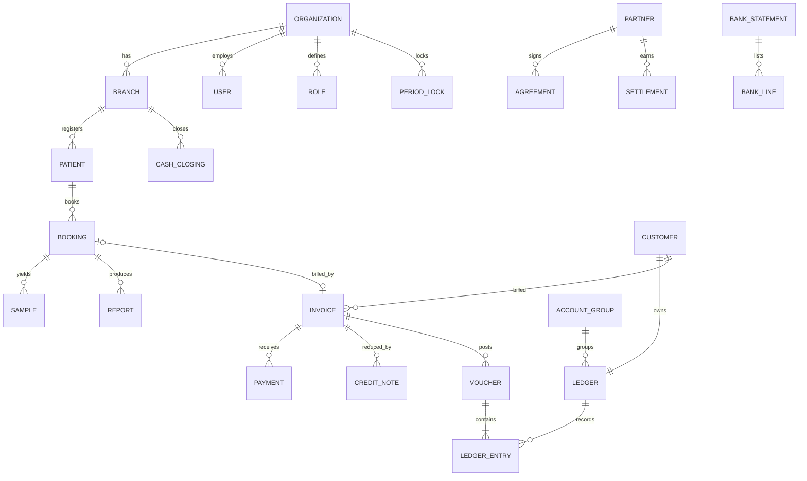

# 10 · Data and money

## Money

- **Integer paise everywhere** (`totalPaise: 35400` = Rs 354.00). Inputs and outputs, no floats.
- The catalog's `mrp` and invoice-kit's print/price-list amounts are **rupees**; the API converts at the
  boundary (`pricePaise = mrp × 100`).
- Rounding is explicit: bill discounts by largest remainder, GST per line, round-off to the rupee.
- Every voucher balances (debits = credits), checked by ledger-kit before it is written.
- Print shows `Rs.` (the report font has no `₹` glyph).

## Dates

| Kind | GraphQL | Meaning |
|---|---|---|
| Instant | `DateTime` (ISO string) | `createdAt`, `verifiedAt`, voucher dates |
| Day | `Day` (`"YYYY-MM-DD"`) | Calendar day **in IST** (cash closings, settlement lines, lock dates, GST invoice days) |
| Period | `String` | Settlement month `"2026-09"`; financial year `"2026-27"` |

The financial year runs 1 April to 31 March (IST). Voucher and invoice numbers restart each year
(`MGPL/ARG01/2026-27/000001`: organisation / branch / year / sequence).

## Storage

All tables and collections belong to **db-kit**, on PostgreSQL (Sequelize) or MongoDB (Mongoose, replica
set for transactions). Both backends pass the same contract tests, and this API's suite runs on both.
Schema changes are db-kit pull requests, never local tables here.

## GST prerequisites

| Needed for | Set |
|---|---|
| Posting any invoice (place of supply → CGST+SGST or IGST) | The branch's `stateCode` (or its `gstin`) |
| GSTR-1 / GSTR-3B | The organisation's `gstin` (or pass `gstin`) |
| B2B invoices to registered buyers | The customer's `gstin` and `stateCode` |
| Taxable lines | Tax rules (`seedTaxRules`, then confirm each with the CA) |

A branch without a state code fails billing with `BAD_USER_INPUT`. The seed script asks for it.

## Personal data

Patients' names, phones, addresses and results are health data. Do not log request bodies, do not copy
production data into tests (fixtures use fictional names), and keep backups encrypted.
