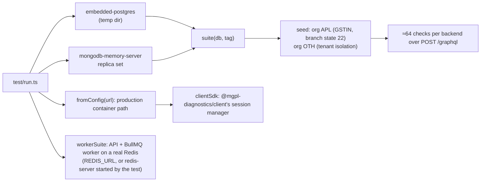

# 11 · Testing

`npm test` runs `test/run.ts`: the real server (Fastify + Yoga) driven over HTTP with `app.inject`, real
auth-kit sessions, and real databases started in-process.



| Area | What the suite proves |
|---|---|
| Server | `/health` and `{ health }`, introspection off when `INTROSPECTION=0`, depth limit 12 |
| PgBouncer | The whole PostgreSQL suite again through PgBouncer in transaction mode (`pgbouncer` on the PATH or `PGBOUNCER_BIN`; skipped with a note otherwise) |
| Replicas | Two API servers sharing PgBouncer and Redis: a session, a refresh and a logout cross replicas; 16 concurrent invoices with unique numbers over a 3-connection server pool; shared login limits; draining and shutdown |
| Auth | no token → `UNAUTHENTICATED`, wrong password → `INVALID_CREDENTIALS`, login, viewer (null without a token), weak password, reset link through the mailer (unknown emails not revealed), reset ends old sessions, disable signs out at once, `mySessions`, logout |
| Permissions | front desk cannot read the books; registers in branch A, not B; lists show only the viewer's branches; discounts need `invoice:discount`; nested vouchers hidden without `accounts:read` |
| Tenancy | another organisation cannot read the invoice, the patient, or print it; cannot post into its ledgers |
| Catalog | search and price quote without sign-in |
| Lab | patient → booking by catalog code → collect → receive → results with unit, range and flag from the catalog → unverified report does not print → verify, release → booking completed |
| Billing | invoice priced from the catalog, partial payment, overpayment refused, payment → paid with sales and receipt vouchers, qty 0 refused |
| Books | chart setup, trial balance balances, manual voucher, unbalanced voucher refused |
| Finance | tax rules, customer + credit invoice, credit limit, statement, credit note, GSTR-1/3B data with the verify-with-CA list, trial balance CSV with TOTAL row, partner + agreement + settlement preview, lock date → `PERIOD_LOCKED` |
| Documents | booking report PDF and non-header HTML, stored invoice PDF + HTML (totals match), `renderReport` / `invoiceTotals` / `reportTemplates`, bad request → `BAD_USER_INPUT` |
| Tokens | access JWT + refresh token, refresh rotates, spent / unknown refresh token → `INVALID_TOKEN`, edited claims refused, `logout(refreshToken)` ends the session |
| Device binding | login stores the device (`mySessions.deviceId`), same device with a new fingerprint refreshes, another device → `INVALID_TOKEN` and the session ends |
| Jobs | `startDocumentJob` → PDF (in-process), only the owner reads `job(id)`, other organisation → `NOT_FOUND`, missing id → `BAD_USER_INPUT` |
| Worker | jobs go to BullMQ, refresh tokens in Redis, reset link sent by the worker, no reset token in the queue, document rendered by the worker |
| Client SDK | login with device signals, 5 parallel calls on an expiring token → 1 refresh, refresh + retry on `UNAUTHENTICATED`, `session.fetch`, logout |
| Client contract | all client operations valid; every root field covered |
| Performance | 10 invoices with nested `patient` → one batched lookup (no N+1) |

Not covered yet (good next tests): refunds and invoice cancellation, settlement accrue/pay/cancel, cash
closing, bank import and reconciliation, year-end close, P&L / balance sheet values, CORS headers, the
login rate limit.

## Running

```bash
npm test                         # PostgreSQL and MongoDB (first run downloads the binaries)
TEST_BACKENDS=pg npm test        # PostgreSQL only
REDIS_URL=redis://localhost:6379 npm test   # the worker suite on this Redis (else redis-server is started, or the suite is skipped)
DEBUG=1 TEST_BACKENDS=pg npm test   # print resolver errors
MONGOMS_SYSTEM_BINARY=/usr/bin/mongod npm test   # behind a proxy that blocks the MongoDB download
```

CI (`.github/workflows/ci.yml`, job id `ci`, required on `main`) runs `npm ci` (kits from GitHub Packages, `packages: read`), typecheck, the tests
on both backends, the build, and checks that `schema.graphql`, `docs/04-api-reference.md` and
`llms-full.txt` are current.

## The client contract

`package.json` pins `@mgpl-diagnostics/client` (a devDependency; `kits.json` for unreleased builds). The `[static]` checks validate every GraphQL operation the
client sends (141) against `buildSchema()` and check that each query and mutation has one, so a renamed
or new field fails here before it reaches an app. Change the client first, release it, then bump its version here.

## Adding a test

Add checks to `suite()` in `test/run.ts` with `ok(condition, "[tag] what it proves")`. Use the `gql(token,
query, variables)` helper and the seeded tokens (`owner`, `desk`, …). Keep fixtures fictional.
