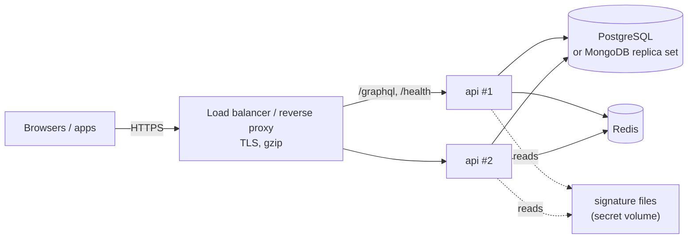

# 12 · Deployment

## Shape



- **One server** can run without Redis (sessions in memory, lost on restart).
- **Two or more servers need Redis**: sessions, reset tokens and login limits must be shared.
- The process is stateless otherwise; scale horizontally.

## Build and run

```bash
npm run kits          # or `npm ci` once every kit is on the registry
npm run build         # dist/main.js
NODE_ENV=production node dist/main.js
```

A container image: Node 22 slim, copy `dist/`, `node_modules/` and `package.json`, run
`node dist/main.js`, expose `PORT`. The PDF engine needs no system fonts (fonts are bundled), but
report-kit's resvg is a native module: build the image on the same platform it runs on.

## Production checklist

| | Item |
|---|---|
| ☐ | `NODE_ENV=production`, `DATABASE_URL`, `REDIS_URL` set from secrets |
| ☐ | `CORS_ORIGINS` lists exactly the app origins (no `*`) |
| ☐ | `GRAPHIQL` and `INTROSPECTION` off (the defaults in production) |
| ☐ | `TRUST_PROXY=true` behind the load balancer (login limits use the client IP) |
| ☐ | `MGPL_SAMPLES` off (the default in production) |
| ☐ | Signature files mounted read-only; `MGPL_SIGNATURE_*_FILE` point at them |
| ☐ | `PASSWORD_RESET_URL` points at the app's reset page, and a `Mailer` is wired (below) |
| ☐ | First organisation seeded (`npm run seed`) with the branch `stateCode` and the org GSTIN |
| ☐ | Tax rules seeded **and confirmed by the CA** (`verifyWithCA`) |
| ☐ | Database backups (point-in-time for Postgres), encrypted |
| ☐ | Health check on `GET /health` (200 `{ ok: true }`, 503 when the database is down) |
| ☐ | Logs shipped; request bodies are not logged (they hold patient data) |

## Sending password-reset emails

`src/main.ts` starts the API without a mailer, so reset links are not sent (the API still answers
`true`). Wire one by embedding:

```ts
import { buildServer, createContainer, loadConfig, type Mailer } from "@mgpl-diagnostics/api";

const mailer: Mailer = {
  async passwordReset(to, link, expiresAt) {
    await sendEmail({ to: to.email, subject: "Reset your password", text: `Hi ${to.name}, ${link} (until ${expiresAt.toISOString()})` });
  },
};
const container = await createContainer({ config: loadConfig(), mailer });
await (await buildServer(container)).listen({ port: container.config.port, host: container.config.host });
```

## Database operations

- **PostgreSQL**: `createDb` creates missing tables on start (`sequelize.sync()`, which never alters
  existing ones). Take a backup before upgrading db-kit and apply any migration its changelog lists.
- **MongoDB**: must be a replica set (transactions). `createDb` syncs indexes on start (`syncIndexes`).
- **Redis**: no persistence needed beyond sessions; losing it signs everyone out.

## Upgrading kits

Bump the version in `package.json` (and the ref in `kits.json` while CI builds from source), run
`npm test` on both backends, regenerate `schema.graphql` if types changed, deploy. tally-kit changes of
behaviour are versioned decisions; read its changelog.
