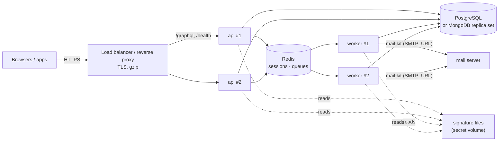

# 12 · Deployment

## Shape



- **One server** can run without Redis (sessions in memory, lost on restart; jobs run in the API process).
- **Two or more servers need Redis**: sessions, refresh tokens and login limits must be shared.
- **Workers** (`node dist/worker.js`) need Redis and the same environment as the API (database,
  `JWT_SECRET`, signature files). Run one or more; see [16-worker.md](16-worker.md).
- The process is stateless otherwise; scale horizontally.

## Build and run

```bash
npm ci                # kits from GitHub Packages (NODE_AUTH_TOKEN with read:packages)
npm run build         # dist/main.js, dist/worker.js
NODE_ENV=production node dist/main.js     # API
NODE_ENV=production node dist/worker.js   # worker (with REDIS_URL)
```

A container image: Node 22 slim, copy `dist/`, `node_modules/` and `package.json`, run
`node dist/main.js`, expose `PORT`. The PDF engine needs no system fonts (fonts are bundled), but
report-kit's resvg is a native module: build the image on the same platform it runs on.

## Production checklist

| | Item |
|---|---|
| ☐ | `NODE_ENV=production`, `DATABASE_URL`, `REDIS_URL` set from secrets |
| ☐ | `JWT_SECRET` set from secrets (≥ 32 random characters, e.g. `openssl rand -base64 48`), the same on every API server |
| ☐ | At least one worker running (`node dist/worker.js`) with `SMTP_URL` and `MAIL_FROM` set |
| ☐ | `CORS_ORIGINS` lists exactly the app origins (no `*`) |
| ☐ | `GRAPHIQL` and `INTROSPECTION` off (the defaults in production) |
| ☐ | `TRUST_PROXY=true` behind the load balancer (login limits use the client IP) |
| ☐ | `MGPL_SAMPLES` off (the default in production) |
| ☐ | Signature files mounted read-only; `MGPL_SIGNATURE_*_FILE` point at them |
| ☐ | `PASSWORD_RESET_URL` points at the app's reset page, and a mailer is wired (below) |
| ☐ | First organisation seeded (`npm run seed`) with the branch `stateCode` and the org GSTIN |
| ☐ | Tax rules seeded **and confirmed by the CA** (`verifyWithCA`) |
| ☐ | Database backups (point-in-time for Postgres), encrypted |
| ☐ | Health check on `GET /health` (200 `{ ok: true }`, 503 when the database is down) |
| ☐ | Logs shipped; request bodies are not logged (they hold patient data) |

## Sending password-reset emails

Set `SMTP_URL` and `MAIL_FROM` (the Mail section of [`.env.example`](../.env.example) shows the URL form
for Gmail, Zoho, Amazon SES and Brevo; URL-encode the user and password). The worker (or the API, without Redis) sends the mail with
[mail-kit](https://github.com/mgpl-diagnostics/mail-kit): the "password-reset" mail is written in its mail
design language and goes out as HTML plus plain text, in the lab's brand (name, address, phone from
report-kit's lab profile). Any SMTP provider works (Gmail or Zoho app passwords, Amazon SES, Brevo);
mail-kit refuses to send without TLS to a remote server. The provider's SPF and DKIM records must cover
the domain in `MAIL_FROM`.

Without `SMTP_URL`, `MAIL_WEBHOOK_URL` still works: the worker POSTs `{ to, subject, text }` JSON to it.
With neither, reset links are not sent (the API still answers `true`). To send another way, embed with your own `Mailer`, in the
worker's process when you run workers:

```ts
import { buildServer, createContainer, loadConfig, type Mailer } from "@mgpl-diagnostics/api";

const mailer: Mailer = {
  async passwordReset(to, link, expiresAt) {
    await sendEmail({ to: to.email, subject: "Reset your password", text: `Hi ${to.name}, ${link} (until ${expiresAt.toISOString()})` });
  },
};
const container = await createContainer({ config: loadConfig(), mailer });
await (await buildServer(container)).listen({ port: container.config.port, host: container.config.host });
```

## Database operations

- **PostgreSQL**: `createDb` creates missing tables on start (`sequelize.sync()`, which never alters
  existing ones). Take a backup before upgrading db-kit and apply any migration its changelog lists.
- **MongoDB**: must be a replica set (transactions). `createDb` syncs indexes on start (`syncIndexes`).
- **Redis**: sessions, refresh tokens and queued jobs. Losing it signs everyone out and drops queued
  jobs; turn on AOF persistence if queued emails must survive a Redis restart.

## Upgrading kits

Bump the version in `package.json` (and the ref in `kits.json` while CI builds from source), run
`npm test` on both backends, regenerate `schema.graphql` if types changed, deploy. ledger-kit changes of
behaviour are versioned decisions; read its changelog.
