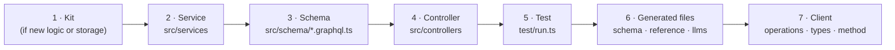

# 13 · Adding a feature

Every feature walks the same layers. Example: **a query `patientInvoicesDue(patientId)`**.



## 1. Does it belong in a kit?

| The change is… | Where |
|---|---|
| A new table, column or repository method | **db-kit** PR (both `mongo/` and `pg/`, contract tests) |
| A domain rule (GST, settlements, credit limits) | **finance-kit** |
| Posting or books reports | **ledger-kit** |
| A permission | **auth-kit** `PERMISSIONS` + the right `SYSTEM_ROLES` |
| A test, range or price | **catalog-kit** `data/catalog.json` |
| A print layout | **report-kit** / **invoice-kit** |
| Wiring, authorisation, mapping to GraphQL | here |

## 2. Service

```ts
// src/services/billing.service.ts
async dueForPatient(actor: Actor, patientId: Id, scope: "all" | Id[]) {
  mustOwn(await this.repos.patients.get(patientId), actor.orgId, "Patient", patientId);
  const invoices = await scopedFind(this.repos.invoices, { patientId }, scope, 200, 0, "createdAt");
  return invoices.filter((i) => i.duePaise > 0 && i.status !== "cancelled");
}
```

Services take `(actor, …)`, check ownership, use the kits, and never import GraphQL.

## 3. Schema

```ts
// src/schema/billing.graphql.ts
extend type Query {
  """Unpaid invoices of one patient, newest first."""
  patientInvoicesDue(patientId: ID!): [Invoice!]!
}
```

## 4. Controller

```ts
// src/controllers/billing.controller.ts, inside Query
patientInvoicesDue: (_: unknown, a: { patientId: string }, ctx: Ctx) =>
  ctx.services.billing.dueForPatient(actorOf(ctx), a.patientId, branchScope(ctx, "invoice:read")),
```

Always: `authorize` / `branchScope` first, ids checked against the organisation, `cap()` on limits.
Controllers are wrapped in `withErrorCodes`, so domain errors get codes automatically.

## 5. Test

```ts
const due = await gql(desk, `query($p: ID!) { patientInvoicesDue(patientId: $p) { invoiceNo duePaise } }`, { p: patientId });
ok(due.data?.patientInvoicesDue.length === 1, `[${tag}] patientInvoicesDue lists the unpaid invoice`);
```

Add a negative check too (another organisation, or a user without the permission).

## 6. Generated files

```bash
npm run typecheck && npm test
npm run schema && npm run docs:reference && npm run llms
```

Update the hand-written docs that describe the area (flows, errors) and add an example to `docs/examples/`.

## 7. Client

In `mgpl-diagnostics/client`: add the operation to `src/graphql/operations.ts`, the result type to
`src/graphql/types.ts`, a method to `src/graphql/client.ts`, a row to `docs/graphql.md`; release; then bump
the client ref here so the contract test covers it.

## Checklist

- [ ] Permission exists in auth-kit and the right roles grant it
- [ ] No `orgId` or `actorId` arguments
- [ ] Money in paise, days as `Day`
- [ ] Multi-record writes inside a kit transaction
- [ ] Nested fields through loaders
- [ ] Positive and negative tests on both backends
- [ ] schema.graphql, 04-api-reference.md, llms-full.txt regenerated
