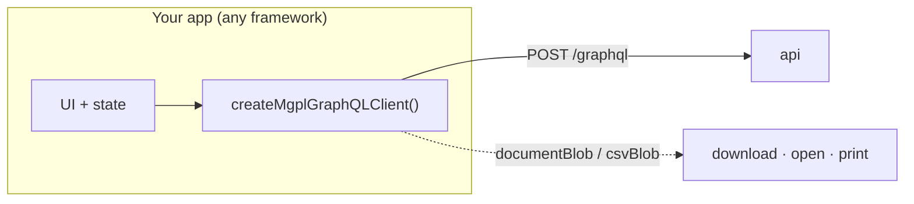

# 14 · Client

Frontends use [`@mgpl-diagnostics/client`](https://github.com/mgpl-diagnostics/client) (zero dependencies).
Its `createMgplGraphQLClient` has one typed method per operation of this API.



```ts
import { createMgplGraphQLClient, documentBlob, printBlob, MgplGraphQLError } from "@mgpl-diagnostics/client";

const mgpl = createMgplGraphQLClient({ url: import.meta.env.VITE_API_URL + "/graphql", onToken: saveToken, token: loadToken() });

await mgpl.auth.login({ email, password, orgCode: "MGPL" });
const me = await mgpl.auth.viewer();
const canBill = await mgpl.auth.can("invoice:create", branchId);

const hits = await mgpl.catalog.search("lft");
const { booking } = await mgpl.bookings.create({ branchId, patientId, tests: hits.slice(0, 1).map((h) => ({ testCode: h.test.code! })) });
const doc = await mgpl.documents.bookingReports(booking.id, { variant: "non_header" });
printBlob(documentBlob(doc));
```

| Need | Method |
|---|---|
| Sign in / out, sessions | `auth.login`, `auth.logout`, `auth.sessions`, `auth.changePassword` |
| Show or hide UI by permission | `auth.viewer().permissions`, `auth.can(permission, branchId)` |
| Result-entry form | `catalog.test(code, sex)` (parameters, units, ranges) or `documents.templates()` |
| Live preview | `documents.renderReport(request, { format: "html" })` |
| Desk | `patients.*`, `bookings.*`, `samples.*`, `invoices.*` |
| Pathologist | `reports.saveResults`, `reports.verify`, `reports.release` |
| Accounts | `books.*`, `gst.*`, `receivables.*`, `settlements.*`, `cash.*`, `bank.*`, `periods.*`, `exports.*` |
| Anything custom | `request(query, variables)` |

Errors arrive as `MgplGraphQLError` with `code` ([05-errors.md](05-errors.md)). The full method list is in
the client's `docs/graphql.md`.

## Without the SDK

Any GraphQL client works (Apollo, urql, graphql-request, plain `fetch`). Send
`Authorization: Bearer <token>` and `content-type: application/json` to `POST /graphql`. The schema is
in [schema.graphql](../schema.graphql) for code generators; introspection is off in production.
