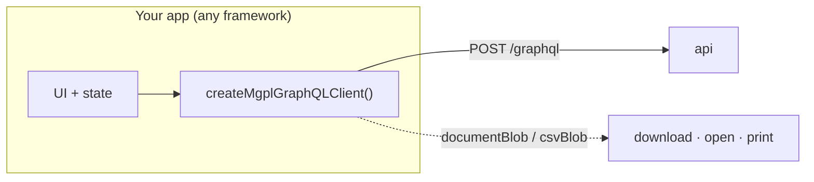
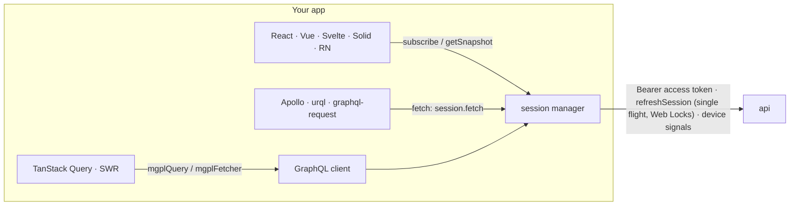

# 14 · Client

Frontends use [`@mgpl-diagnostics/client`](https://github.com/mgpl-diagnostics/client) (zero dependencies).
Its `createMgplGraphQLClient` has one typed method per operation of this API.



```ts
import { createMgplGraphQLClient, createSessionManager, webSessionStorage, documentBlob, printBlob } from "@mgpl-diagnostics/client";

const session = createSessionManager({ url: import.meta.env.VITE_API_URL + "/graphql", storage: webSessionStorage() });
const mgpl = createMgplGraphQLClient({ url: import.meta.env.VITE_API_URL + "/graphql", session });

await mgpl.auth.login({ email, password, orgCode: "MGPL" });   // device signals added; tokens kept and refreshed
const me = await mgpl.auth.viewer();
const canBill = await mgpl.auth.can("invoice:create", branchId);

const hits = await mgpl.catalog.search("lft");
const { booking } = await mgpl.bookings.create({ branchId, patientId, tests: hits.slice(0, 1).map((h) => ({ testCode: h.test.code! })) });
const doc = await mgpl.documents.bookingReports(booking.id, { variant: "non_header" });
printBlob(documentBlob(doc));
```

| Need | Method |
|---|---|
| Sign in / out, sessions | `auth.login`, `auth.logout`, `auth.refresh` (automatic), `auth.sessions`, `auth.changePassword` |
| Session state in any UI library | `mgpl.session.subscribe` / `getSnapshot` / `store`, `useMgplSession` (React) |
| TanStack Query, SWR | `mgplQuery`, `mgplMutation`, `mgplKey`, `mgplFetcher`, `clearOnSignOut` |
| Background documents | `documents.startJob`, `documents.waitForJob` |
| Show or hide UI by permission | `auth.viewer().permissions`, `auth.can(permission, branchId)` |
| Result-entry form | `catalog.test(code, sex)` (parameters, units, ranges) or `documents.templates()` |
| Live preview | `documents.renderReport(request, { format: "html" })` |
| Desk | `patients.*`, `bookings.*`, `samples.*`, `invoices.*` |
| Pathologist | `reports.saveResults`, `reports.verify`, `reports.release` |
| Accounts | `books.*`, `gst.*`, `receivables.*`, `settlements.*`, `cash.*`, `bank.*`, `periods.*`, `exports.*` |
| Anything custom | `request(query, variables)` |

Errors arrive as `MgplGraphQLError` with `code` ([05-errors.md](05-errors.md)). The full method list is in
the client's `docs/graphql.md`.

## Sessions with any library



The client's [docs/session.md](https://github.com/mgpl-diagnostics/client/blob/main/docs/session.md)
has the details: storages, cross-tab refresh, device signals and what they contain.

## Without the SDK

Any GraphQL client works. Send `Authorization: Bearer <accessToken>` and
`content-type: application/json` to `POST /graphql`. When a request returns `UNAUTHENTICATED`, call
`refreshSession(refreshToken, device)` once and retry; on `INVALID_TOKEN`, sign in again. The schema is
in [schema.graphql](../schema.graphql) for code generators; introspection is off in production.
