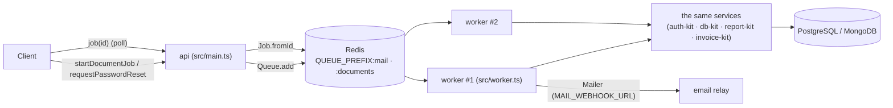
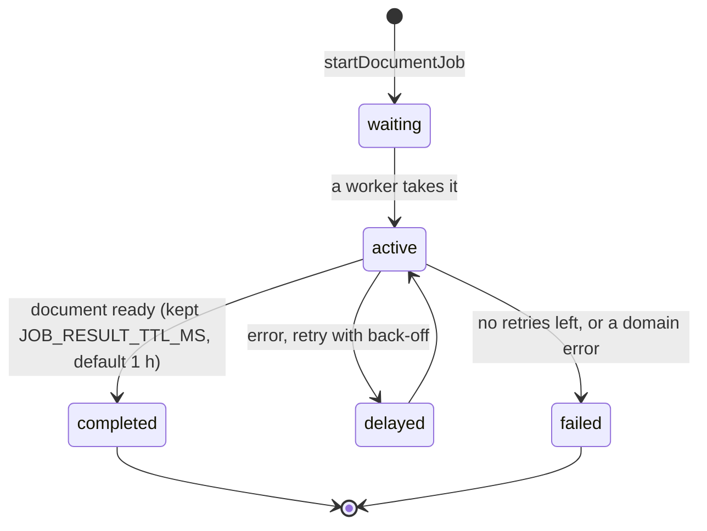

# 16 · Worker (Redis + BullMQ)

Slow or outward-facing work runs outside the request, in a **worker process**: the same code, config
and services as the API, with a second entry point (`src/worker.ts`). The API puts jobs in Redis with
[BullMQ](https://docs.bullmq.io); any number of workers take them.



## Queues and jobs

| Queue | Job | Started by | What the worker does | Retries |
|---|---|---|---|---|
| `mail` | `password-reset` | `requestPasswordReset` | creates the single-use token (auth-kit), sends the link through the `Mailer` | 5, exponential from 2 s; a rate-limited request is dropped |
| `documents` | `invoice` · `booking_reports` | `startDocumentJob` | renders the stored invoice or the booking's reports (invoice-kit / report-kit) | 2; NOT_FOUND / CONFLICT / BAD_USER_INPUT fail at once |



## Security

- **No raw token in Redis.** A password-reset job carries only `{ email, orgCode, ip }`; the worker
  creates the token and hands it straight to the mailer. The test suite checks the queue keys.
- **Same answer for every email.** `requestPasswordReset` only enqueues, so its timing does not reveal
  whether the account exists.
- **Permissions at the door, user re-read at work.** `startDocumentJob` loads the record and checks
  `invoice:read` / `report:read` on its branch before queueing. The worker re-reads the user and fails
  the job when the user has been disabled or moved.
- **Only the owner reads a job.** Job ids are random UUIDs, and `job(id)` returns null unless the
  signed-in user started it (same organisation).
- Job errors shown to clients are domain messages or "Rendering failed"; stack traces stay in the worker log.

## Running

```bash
REDIS_URL=redis://localhost:6379 npm run dev            # API
REDIS_URL=redis://localhost:6379 npm run worker:dev     # worker (watch)

npm run build && npm start                              # production API: dist/main.js
npm run worker                                          # production worker: dist/worker.js
```

The worker refuses to start without `REDIS_URL`. **Without Redis** the API runs jobs in its own
process at once (`createInlineJobQueue`): same GraphQL, same results, the request just waits. That is
what development and one-server installs get.

| Variable | Default | |
|---|---|---|
| `REDIS_URL` | — | Turns on BullMQ; required by the worker |
| `QUEUE_PREFIX` | `mgpl` | Redis key prefix (separate apps or environments) |
| `WORKER_CONCURRENCY` | `4` | Jobs per worker at once, per queue |
| `JOB_RESULT_TTL_MS` | `3600000` | How long finished jobs (and their documents) stay readable |
| `MAIL_WEBHOOK_URL` | — | Email relay: POST `{ to, subject, text }` JSON (your provider's API or a small function) |

Shutdown (`SIGTERM`) lets the jobs in hand finish, then closes the database.

## From the client

```ts
const job = await mgpl.documents.startJob({ kind: "invoice", invoiceId });
const done = await mgpl.documents.waitForJob(job.id);       // polls job(id); throws if it failed
openBlob(documentBlob(done.document!));
```

## Adding a job

1. Its payload type in `src/jobs/types.ts` (ids and the actor, never secrets), and a method on `JobQueue`.
2. A processor in `src/jobs/processors.ts` that calls services. Throw `JobFailure(message, false)` when
   retrying cannot help.
3. Add it to both queues: `bullmq.ts` (`Queue.add`, a `Worker`) and `inline.ts`.
4. A service method that enqueues it; a controller that checks permissions first.
5. Tests: the in-process path in `suite()` and the BullMQ path in `workerSuite()` (`test/run.ts`).

Repeatable jobs (a nightly day-end reminder, say) use `queue.upsertJobScheduler(...)` in the worker entry.
