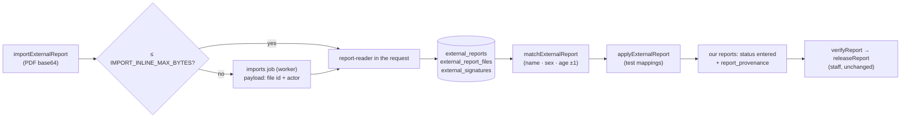

# 18 · Partner-lab report imports

Some tests are performed by partner labs (Hy Patho Lab, Clinova Pathlabs). Their PDF report can be
uploaded and read by [report-reader](https://github.com/mgpl-diagnostics/report-reader). The results
are then matched to our booking and written into our reports **as entered results with their
provenance**. Our staff verify and release them as usual. An import never verifies or releases anything.

## The flow

| Step | Field | Permission | Notes |
|---|---|---|---|
| Upload | `importExternalReport(pdfBase64, fileName, bookingId, branchId)` | `report:import` in the branch | `branchId` defaults to the booking's. The same PDF again returns the same import (by SHA-256). A PDF the reader does not support → `UNSUPPORTED_REPORT`, and its file is not kept. |
| Review | `externalReport(id)`, `externalReports(branchId, bookingId, status, first, after)` | `report:import` | Tests with parameters as printed, `suggestedTestCode` (once matched, the best catalog hit among the booking's tests; otherwise the top hit), the provenance line each test will print, signatories and `warnings`. |
| Find the booking | `ExternalReport.candidates(first)` | `report:import` (lists only bookings in those branches) | Patients found by the printed name (whole, then each word), their bookings of the last 90 days that are not cancelled, scored 0 to 100: name (same, in part, first name), sex, age ±1, partner tests that map to booked tests (catalog search among the booking's codes), how recent. `strong` = name, sex and age agree and a test maps. Each candidate carries its `reasons`, `patientMismatches` and per-test `mappings`. |
| Auto-match | on upload without `bookingId` | — | When exactly one strong candidate in the upload's branch stands out (no other strong one within 20 points), the import is matched to it at once (status `matched`, audited `external_report.auto_match`). Staff still check and apply; matching another booking undoes it. Nothing is applied automatically. |
| Match | `matchExternalReport(id, bookingId)` | `report:import` (both branches) | Compares the patient: name case-insensitive without titles, sex, age within ±1 year. Each difference is listed in `patientMismatches`. |
| Apply | `applyExternalReport(id, mappings, confirmPatientMismatch)` | `report:import` + `report:enter` | One mapping per partner test: `{ testIndex, testCode }` (a test in the booking). Parameters map to our catalog names within the chosen test. Values, units, ranges and flags are copied **as printed**. Ranges are never recomputed. With mismatches, `confirmPatientMismatch: true` is required (otherwise `BOOKING_PATIENT_MISMATCH`). Applying twice → `REPORT_ALREADY_APPLIED`. |
| Reject | `rejectExternalReport(id, reason)` | `report:import` | |
| Name a signature | `nameExternalSignature(input)` | `signatory:manage` | Hy Patho prints no names under signatures. Staff name one once (by its `sha`). The org's imports that are still `extracted` or `matched` and carry it are read again (a `reextract` job). |
| Registry | `externalSignatories(lab)` | `signatory:read` | Data entered by staff, never code. |

Statuses: `extracted` → `matched` → `applied`, or `rejected`.

## The rules

1. **NABL belongs to the performing lab, per test.** The line "NABL accredited laboratory
   (Certificate No. …)" prints only under tests the partner marked accredited (`accredited: true`). It
   is worded as the partner's accreditation. No NABL or ilac logo is ever drawn. Hy Patho reports carry
   no marks, so they never get the line.
2. **A partner signature only appears with results from its own PDF.** Signature PNGs are stored with
   the SHA-256 of the PDF they came from. They are looked up by (organisation, that PDF's SHA-256, image
   SHA), both in `ExternalSignatoryOnReport.image` and when printing. A stored signature is never picked
   for another report, and never used as our own signatory.
3. **"Reported by" lists medical signatories only.** Lab managers and other staff sign the PDF but are
   not listed.
4. **Our staff still verify.** Applied reports are `entered`. Printing needs `verifyReport` as before.
   Edits after import are audited (`report.edit_imported`, with parameter names only). Catalog defaults
   are not filled into imported results. `Report.provenance.importedResults` keeps the original.
5. **Patient data.** The PDF, the extracted JSON and the signature PNGs are stored per organisation and
   never logged. Job payloads carry the stored file's id and the actor, never the file or a token. Tests
   draw fictional PDFs (`test/partner-pdfs.ts`).

## Printing

`bookingReportDocument` prints each imported report's provenance under its last section:
"Performed at Clinova Pathlabs, Central Lab, City · NABL accredited laboratory (Certificate No. …) ·
Reported by Dr …". In the Navy Sidebar design, a page whose tests all come from one partner PDF prints
the partner's medical signatory and signature **instead of** ours (report-kit's default). The QC stamp
stays.

## Limits and configuration

| Variable | Default | Meaning |
|---|---|---|
| `IMPORT_MAX_BYTES` | 15 MiB | Largest PDF (`FILE_TOO_LARGE`, with `extensions.maxBytes`) |
| `IMPORT_INLINE_MAX_BYTES` | 5 MiB | Larger PDFs are read by the worker (BullMQ). Without Redis everything runs in the request |
| `IMPORT_WAIT_MS` | 60000 | How long the request waits for the worker |

The HTTP body limit is raised to fit a base64 PDF of `IMPORT_MAX_BYTES`, but **only for an operation
whose single root field is `importExternalReport`**. Every other request keeps `BODY_LIMIT_BYTES` (413,
`FILE_TOO_LARGE`). `importExternalReport` counts as a document field (at most 3 per request).

## Example

[examples/imports.graphql](examples/imports.graphql)

## Storage

db-kit 2.1.1 tables (both backends): `external_reports`, `external_report_files` (the PDF, loaded only
when reading it), `external_signatories` (cached per organisation, cleared on write),
`external_signatures` and `report_provenance`. See db-kit's `docs/EXTERNAL-REPORTS.md`.
