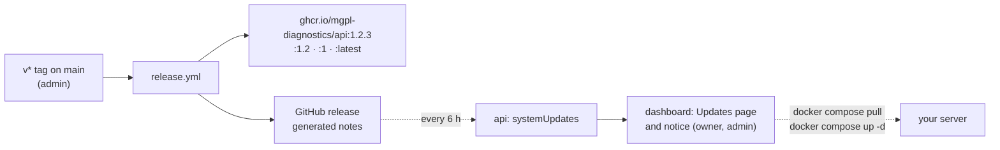

# 18 · Releases, Docker images and updates

Every release of the api and of the dashboard publishes a Docker image, and owners and admins see in the
dashboard when a newer one is out: which version runs, which is the newest, what changed in between, and
the commands to update.



## Images

| Image | Runs | Port |
|---|---|---|
| `ghcr.io/mgpl-diagnostics/api` | `node dist/main.js` (api), `node dist/worker.js` (worker), `node dist/sync.js` (tables) | 4000 |
| `ghcr.io/mgpl-diagnostics/dashboard` | `node server.js` (Next.js standalone); `MGPL_API_URL` is read at start | 3000 |

Tags: the exact version (`1.2.3`), the minor line (`1.2`), the major line (`1`, from 1.0.0 on) and `latest`.
Both are built for `linux/amd64` and `linux/arm64`.

## Hosting with Docker Compose

[`docker-compose.yml`](../docker-compose.yml) runs everything on one host: PostgreSQL, PgBouncer, Redis,
`db-sync`, the api replicas, the worker, the dashboard and nginx in front of them on `HTTP_PORT` (8080).
nginx sends `/graphql` and `/health` to the api and everything else to the dashboard, so the browser sees one
origin.

```bash
mkdir mgpl && cd mgpl
curl -fsSLO https://raw.githubusercontent.com/mgpl-diagnostics/api/main/docker-compose.yml
mkdir deploy && curl -fsSL -o deploy/nginx.conf https://raw.githubusercontent.com/mgpl-diagnostics/api/main/deploy/nginx.conf
curl -fsSL -o .env https://raw.githubusercontent.com/mgpl-diagnostics/api/main/.env.example
# edit .env: NODE_ENV=production, JWT_SECRET, POSTGRES_PASSWORD, CORS_ORIGINS=https://your-lab-domain, SMTP_URL, …
docker compose up -d
```

Seed the first organisation once ([03-getting-started.md](03-getting-started.md)). Then open `http://your-server:8080` (put TLS in front: a CDN or cloud load balancer, then `TRUST_PROXY=2`, or a
`listen 443 ssl` server in `deploy/nginx.conf`). `CORS_ORIGINS` lists the address people open.

To build the api from a checkout instead of pulling it, add the build file:
`NODE_AUTH_TOKEN=… docker compose -f docker-compose.yml -f docker-compose.build.yml up -d --build`.

## Updating

The dashboard's **Updates** page (Organisation → Updates, for roles with `settings:manage`: owner and
admin) shows both parts with their versions, the release notes in between and the steps. By hand:

```bash
pg_dump … > backup.sql            # or your provider's snapshot: always before an update
# in .env: MGPL_API_VERSION=1.3.0 and MGPL_DASHBOARD_VERSION=1.3.0 (or leave both "latest")
docker compose pull
docker compose up -d              # db-sync adds new tables first, then api, worker and dashboard restart
docker compose ps                 # all up, api healthy
```

Sessions live in Redis, so people stay signed in. To go back, set the previous versions in `.env` and run the
same two commands (a release that changes stored data says so in its notes).

Pin versions in production (`MGPL_API_VERSION=1.3.0` rather than `latest`), so a restart never upgrades by surprise.

## How the check works

`systemUpdates(dashboardVersion, refresh)` (permission `settings:manage`) compares the api's own version
(its `package.json`) and the version the dashboard sends (its build) with the newest published, non-pre-release
GitHub releases of `mgpl-diagnostics/api` and `mgpl-diagnostics/dashboard`. Each api process asks GitHub at
most once per `UPDATE_CHECK_INTERVAL_MS` (6 hours); "Check now" skips that, at most once a minute. GitHub
allows 60 unauthenticated calls an hour per IP, which is plenty; `UPDATE_GITHUB_TOKEN` (a token with no
scopes) raises it. A failed check keeps the last answer and says why. Nothing about the lab is sent: one GET per repository.

| Variable | Default | Meaning |
|---|---|---|
| `UPDATE_CHECK` | `true` (`false` in tests) | `false`: no outbound call; the page shows the running versions only |
| `UPDATE_CHECK_INTERVAL_MS` | `21600000` (6 h, at least 60000) | How long one check is reused |
| `UPDATE_GITHUB_TOKEN` | empty | Optional; raises GitHub's rate limit |
| `UPDATE_REPO_API`, `UPDATE_REPO_DASHBOARD` | `mgpl-diagnostics/api`, `…/dashboard` | Where releases are read (a fork) |
| `UPDATE_FEED_URL` | `https://api.github.com` | GitHub Enterprise, or a mirror with the same API |
| `IMAGE_REGISTRY` | `ghcr.io` | Shown in the image names |

## Releasing

1. Bump `version` in `package.json` in a PR (api and dashboard version separately) and merge it.
2. An admin pushes the tag: `git tag v1.3.0 && git push origin v1.3.0`, or runs **Release** by hand on `main`.
3. `release.yml` checks the tag equals `package.json`, builds and pushes the image, and creates the GitHub
   release with generated notes (edit them on GitHub afterwards: the dashboard shows the release body).

The first time, make each package public once: GitHub → the organisation → Packages → `api` / `dashboard` →
Package settings → Change visibility → Public (or keep them private and `docker login ghcr.io` on the server
with a token that has `read:packages`).

## Why there is no "Update now" button

Updating stays two commands run by a person on the server, on purpose: an updater would need the Docker
socket (root on the host), and every update should follow a database backup. The dashboard shows what to run.
