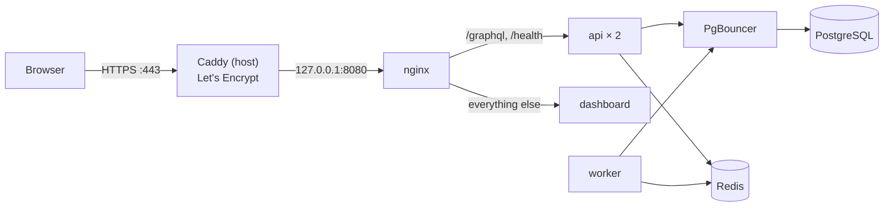

# 20 · Hosting on a VPS

The whole system (api, worker, dashboard, PostgreSQL, PgBouncer, Redis, nginx) on one Linux server with
Docker Compose, behind HTTPS on your own domain. It uses the released images
([19-updates.md](19-updates.md)), so the server needs no Node.js, no source code and no build.



## 1. Server

- Ubuntu 24.04 LTS (or Debian 12), 2 vCPU, 4 GB RAM, 40 GB disk is enough for one lab. In India, pick a
  Mumbai or Hyderabad region.
- A domain or subdomain, for example `lab.example.in`, with an **A record** pointing at the server's IP.

As root, once:

```bash
adduser mgpl && usermod -aG sudo mgpl          # a normal user for everything below
# SSH keys only: copy your key to /home/mgpl/.ssh/authorized_keys, then in /etc/ssh/sshd_config set
# PasswordAuthentication no and PermitRootLogin no, and run: systemctl restart ssh
apt update && apt -y upgrade && apt -y install ufw unattended-upgrades
ufw allow OpenSSH && ufw allow 80 && ufw allow 443 && ufw enable
curl -fsSL https://get.docker.com | sh && usermod -aG docker mgpl
```

Docker's published ports bypass ufw, which is why the compose stack listens on `127.0.0.1` only (step 3).

## 2. Files

As `mgpl`:

```bash
mkdir -p ~/mgpl/deploy && cd ~/mgpl
base=https://raw.githubusercontent.com/mgpl-diagnostics/api/main
curl -fsSLO $base/docker-compose.yml
curl -fsSL -o deploy/nginx.conf $base/deploy/nginx.conf
curl -fsSL -o .env $base/deploy/production.env.example && chmod 600 .env
```

The images are on GHCR. While the packages are private, sign in once with a GitHub token that has
`read:packages`: `echo TOKEN | docker login ghcr.io -u YOUR_GITHUB_LOGIN --password-stdin`.

## 3. Production `.env`

Edit `.env` and replace every `CHANGE_ME` ([`deploy/production.env.example`](../deploy/production.env.example)):

| Variable | Value |
|---|---|
| `MGPL_API_VERSION`, `MGPL_DASHBOARD_VERSION` | A release, e.g. `1.0.0` (or `latest`) |
| `HTTP_PORT` | `127.0.0.1:8080`: nginx is reachable only through Caddy |
| `TRUST_PROXY` | `2` (Caddy, then nginx): login limits see the real client IP |
| `NODE_ENV` | `production` |
| `CORS_ORIGINS` | `https://lab.example.in`: the one origin of the dashboard and the api. Sign-in cookies (httpOnly, Secure, SameSite=Strict) are accepted only from it ([06](06-auth-and-permissions.md#cookies-or-bearer)); leave `AUTH_COOKIE_*` at their defaults |
| `PASSWORD_RESET_URL` | `https://lab.example.in/reset-password` |
| `JWT_SECRET` | `openssl rand -base64 48` |
| `POSTGRES_PASSWORD` | `openssl rand -hex 24` |
| `SMTP_URL`, `MAIL_FROM` | Your mail provider (Zoho, Gmail app password, SES, Brevo); the domain's SPF/DKIM must cover `MAIL_FROM` |
| `GRAPHIQL`, `INTROSPECTION`, `MGPL_SAMPLES` | `false` |

Every other variable is in [09-configuration.md](09-configuration.md). For real signatures, put the PNGs in
`/home/mgpl/mgpl/secure` (`chmod 700`), uncomment the `volumes` line under `x-api` in `docker-compose.yml`
(`["./secure:/secure:ro"]`) and set `MGPL_SIGNATURE_HEADER_FILE` / `MGPL_SIGNATURE_NONHEADER_FILE`.

## 4. Start, and create the first lab

```bash
docker compose up -d            # pulls the images, creates the tables (db-sync), starts everything
docker compose ps               # api "healthy", the others "running"; db-sync "exited (0)"

# the first lab, branch and owner (once). The password is read from your shell, not typed on the command line.
read -rsp "Owner password: " SEED_OWNER_PASSWORD && export SEED_OWNER_PASSWORD && echo
docker compose run --rm \
  -e SEED_ORG_NAME="Maa Gayatri Path Lab" -e SEED_ORG_CODE=MGPL -e SEED_ORG_GSTIN=22AAAAA0000A1Z5 \
  -e SEED_BRANCH_CODE=ARG01 -e SEED_BRANCH_NAME=Arang -e SEED_BRANCH_STATE=22 \
  -e SEED_OWNER_NAME="Lab Owner" -e SEED_OWNER_EMAIL=owner@example.in -e SEED_OWNER_PASSWORD \
  db-sync node dist/seed.js
unset SEED_OWNER_PASSWORD
```

`SEED_ORG_GSTIN` is optional (needed for GST returns); `SEED_BRANCH_STATE` is the GST state code (22 =
Chhattisgarh). The tax rules still need the CA's confirmation before billing ([12-deployment.md](12-deployment.md)).

## 5. HTTPS with Caddy

Caddy on the host gets and renews the Let's Encrypt certificate by itself.

```bash
sudo apt install -y debian-keyring debian-archive-keyring apt-transport-https curl
curl -1sLf 'https://dl.cloudsmith.io/public/caddy/stable/gpg.key' | sudo gpg --dearmor -o /usr/share/keyrings/caddy-stable-archive-keyring.gpg
curl -1sLf 'https://dl.cloudsmith.io/public/caddy/stable/debian.deb.txt' | sudo tee /etc/apt/sources.list.d/caddy-stable.list
sudo apt update && sudo apt install -y caddy
sudo tee /etc/caddy/Caddyfile >/dev/null <<'CADDY'
lab.example.in {
	encode zstd gzip
	reverse_proxy 127.0.0.1:8080
}
CADDY
sudo systemctl reload caddy
```

Open `https://lab.example.in`, sign in as the owner and change the password. `https://lab.example.in/health`
answers `{"ok":true,…}`.

## 6. Backups

PostgreSQL holds everything (patients, reports, invoices, books). A daily dump, kept 14 days, plus a copy
off the server:

```bash
mkdir -p ~/backups && crontab -e
# 02:30 IST every day (the server clock is usually UTC: 21:00 UTC)
0 21 * * * cd ~/mgpl && docker compose exec -T postgres pg_dump -U postgres -Fc mgpl > ~/backups/mgpl-$(date +\%F).dump && find ~/backups -name 'mgpl-*.dump' -mtime +14 -delete
```

Copy `~/backups` off the server every day (rclone to S3-compatible storage or Google Drive, or your VPS
provider's snapshots), encrypted: these files hold patient data. Test a restore now and then:

```bash
docker compose exec -T postgres pg_restore -U postgres -d mgpl --clean --if-exists < ~/backups/mgpl-2026-11-10.dump
```

Keep a copy of `.env` (with `JWT_SECRET` and `POSTGRES_PASSWORD`) in a password manager, not with the dumps.

## 7. Updates

Owners and admins see "Update available" in the dashboard (Organisation → Updates), with the release notes.
Back up first, then:

```bash
cd ~/mgpl
# .env: MGPL_API_VERSION=… and MGPL_DASHBOARD_VERSION=… (the versions the Updates page shows)
docker compose pull && docker compose up -d
docker compose ps
```

Roll back by setting the previous versions and running the same two commands. Details:
[19-updates.md](19-updates.md).

## Everyday commands

```bash
docker compose ps                         # what runs
docker compose logs -f --tail 100 api     # api logs (worker, dashboard, nginx the same way)
docker compose restart worker             # restart one service
docker compose up -d --scale api=3        # more api replicas
```

## Checklist

| | |
|---|---|
| ☐ | DNS A record → server; ufw allows only 22, 80, 443; SSH keys only |
| ☐ | `.env` has no `CHANGE_ME`, `chmod 600`, a copy in a password manager |
| ☐ | `HTTP_PORT=127.0.0.1:8080`, `TRUST_PROXY=2`, Caddy serves HTTPS |
| ☐ | `CORS_ORIGINS` is exactly `https://` + your domain; after signing in, the browser shows `__Host-mgpl_access` and `__Host-mgpl_refresh` as HttpOnly cookies and no token in Local Storage |
| ☐ | First lab seeded, owner password changed after the first sign-in |
| ☐ | A password-reset mail arrives (SMTP works) |
| ☐ | Daily dump runs, copies leave the server, one restore tested |
| ☐ | Versions pinned in `.env` |
