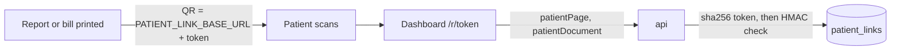

# 21. Patient links

The QR printed on a booking's reports and bills opens a public, read-only page: that booking's bills and
released reports, and nothing else. The patient needs no account and no password; the link is the key.

## Turning it on

| Variable | Default | |
|---|---|---|
| `PATIENT_LINK_SECRET` | empty (off) | HMAC key for the tokens, 32+ characters. Keep it private; changing it stops every printed QR (the next print makes new links) |
| `PATIENT_LINK_BASE_URL` | empty (off) | The public page the token is appended to, e.g. `https://dashboard.example.in/r/`. https only (localhost may be http) |
| `PATIENT_LINK_DAYS` | `180` | How long a link works |
| `PATIENT_LINK_PER_IP` | `60` | Patient page calls per IP per 10 minutes (shared through Redis when `REDIS_URL` is set) |

With both the secret and the base URL set, every printed report (`bookingReportDocument`) and every bill of a
booking (`invoiceDocument`) carries the link in its QR, instead of the old summary QR. Without them nothing
changes.

## How a link is made and checked

- The token is `HMAC-SHA256(PATIENT_LINK_SECRET, nonce)` as base64url (43 characters); the nonce is 24 random bytes.
- db-kit stores only `sha256(token)` and the nonce ([db-kit docs/PATIENT-LINKS.md](https://github.com/mgpl-diagnostics/db-kit/blob/main/docs/PATIENT-LINKS.md)).
  A copy of the database alone cannot open a link, and the api can print the same link again.
- A booking keeps one live link: printing twice prints the same QR. A link made with another secret is replaced.
- Opening looks the row up by hash, checks it is live (not expired, not revoked, booking not cancelled), then
  compares the token with the HMAC of the row's nonce in constant time.
- Unknown, expired, revoked and malformed tokens all answer `null`. Every patient call counts against the
  caller's IP, good token or not (`RATE_LIMITED` with `retryAfterMs`).
- Tokens and nonces are never logged and never put in jobs.

## What the patient sees

`patientPage(token)`: the lab's name, the patient's shortened name ("Ravi K. S."), the booking number and date,
the branch's name, phone and address, the issued bills (drafts and cancelled bills are left out), the released
reports (verified ones are not given out yet), and the tests still in the lab. Each call counts a view.

`patientDocument(token, kind, invoiceId)`: a PDF of one of those bills (`kind: invoice`) or of the released
reports printed together (`kind: reports`). An id from anywhere else answers `NOT_FOUND`.

## Staff

| Field | Permission | |
|---|---|---|
| `patientLink(bookingId)` | `booking:read` + `report:read` on the booking's branch | The link to send or show, made on first use |
| `revokePatientLinks(bookingId)` | `booking:update` | Stops every link of the booking at once (printed QRs stop opening); audited as `patient_link.revoke`. The next print makes a new link |

See [examples/patient-links.graphql](examples/patient-links.graphql).
