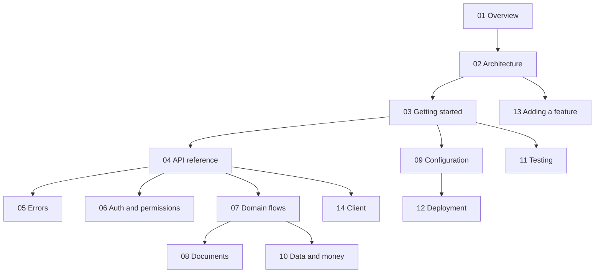

# MGPL Diagnostics API: documentation

Everything about the backend, from A to Z. Start with the overview, then read what you need.

| # | Page | What it answers |
|---|---|---|
| 01 | [Overview](01-overview.md) | What the API is, what it serves, and what it is not |
| 02 | [Architecture](02-architecture.md) | Layers, folders, the request lifecycle, how the kits fit |
| 03 | [Getting started](03-getting-started.md) | Run it locally, seed the first organisation, the first queries |
| 04 | [API reference](04-api-reference.md) | Every query and mutation, with its permission (generated) |
| 05 | [Errors](05-errors.md) | Error codes, masking, how clients should react |
| 06 | [Auth and permissions](06-auth-and-permissions.md) | Sessions, roles, branch scoping, tenant isolation |
| 07 | [Domain flows](07-domain-flows.md) | Booking → sample → report → invoice → books, with state diagrams |
| 08 | [Documents](08-documents.md) | Report and invoice PDFs/HTML through GraphQL |
| 09 | [Configuration](09-configuration.md) | Every environment variable |
| 10 | [Data and money](10-data-and-money.md) | Paise, IST days, financial years, storage backends, GST prerequisites |
| 11 | [Testing](11-testing.md) | The end-to-end suite and how to extend it |
| 12 | [Deployment](12-deployment.md) | Production checklist, scaling, Redis, signatures |
| 13 | [Adding a feature](13-adding-a-feature.md) | Schema → controller → service → test → docs, step by step |
| 14 | [Client](14-client.md) | Using `@mgpl-diagnostics/client` against this API |
| 15 | [Glossary](15-glossary.md) | Lab, billing and accounting terms |
| — | [examples/](examples/) | Runnable `.graphql` operations |
| — | [LOCAL-AGENT-BRIEF.md](LOCAL-AGENT-BRIEF.md) | What a local agent (or a person) must do next, outside this repo |
